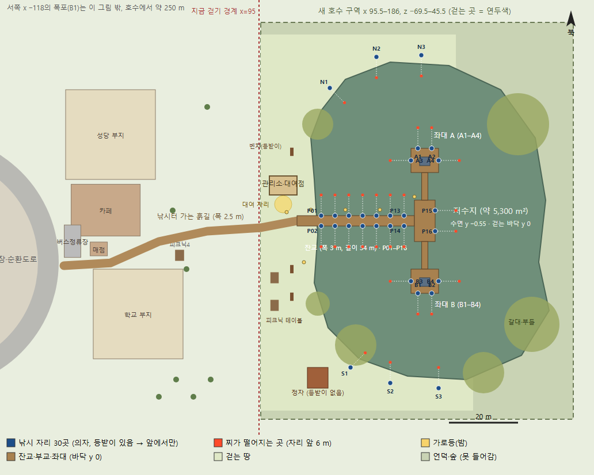
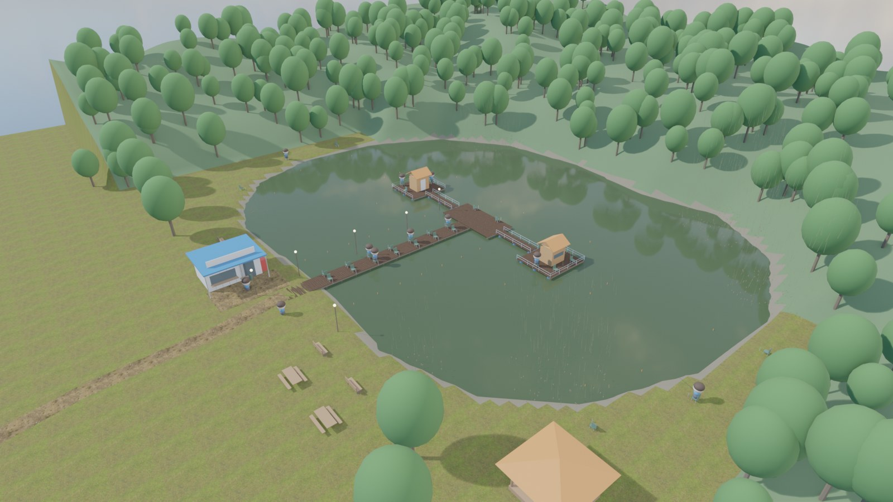
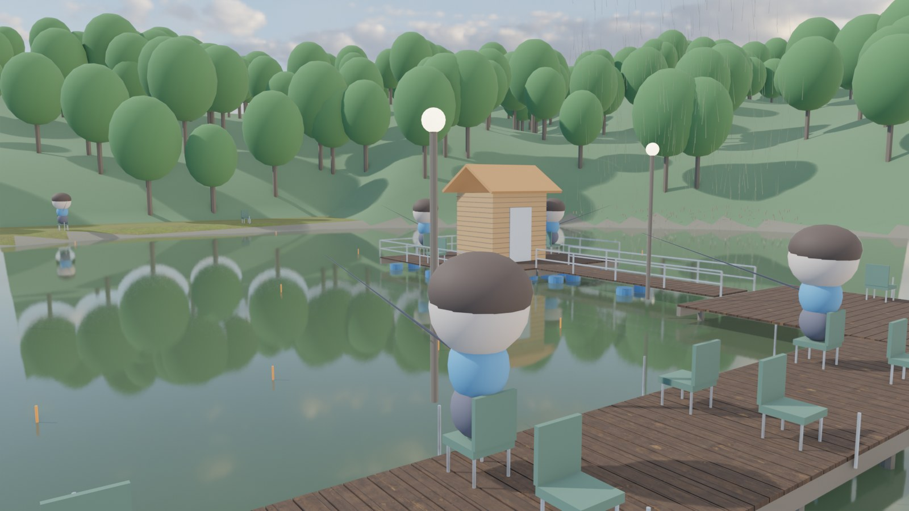

# 낚시터 (A10) 설계안 — 걸어가는 저수지, 빌린 낚싯대, 찌낚시

2026-11-16 · 설계 담당(최상위 모델) · 브랜치 `feat/lake-fishing` · 상태: **설계안, 주인님 확인 대기**

> 한 줄 요약: 마을 동쪽 숲 가장자리를 열어 **약 5,300 m² 저수지**를 걸어서 가는 새 구역으로 만들어요. 물가 **관리소·대여점**에서 아저씨에게 낚싯대(2칸 민장대)를 빌리면 손에 들려요. 잔교·좌대·물가의 **낚시 자리 30곳**(방 정원과 같은 수) 중 빈 의자에 앉아 **던지기 → 찌 지켜보기 → 당기기**를 해요. 붕어는 찌가 솟고, 잉어·메기는 찌를 끌고 들어가요. 큰 고기는 드물고(한 마리당 약 5 %), 걸리면 버튼을 꾹 눌러 끌어내고 뜰채로 떠요. 모든 판단은 서버가 하고, 다른 사람도 낚싯대·찌·입질·고기를 그대로 봐요. 호수는 **따로 받는 GLB**(`lake.glb`)라 `village.glb`를 다시 굽지 않고 시작할 수 있어요.

목업:
- 평면도: [`plan.svg`](plan.svg) / [`plan.png`](plan.png)
- 블록아웃(Blender, 상자·구 모양 자리잡기용 — **최종 모양이 아님**): [`blockout_aerial.jpg`](blockout_aerial.jpg), [`blockout_pier.jpg`](blockout_pier.jpg)
- 목업을 만든 스크립트(배치 숫자의 원본): [`mockup_src/lake_layout.py`](mockup_src/lake_layout.py), `plan_svg.py`, `blockout.py`







---

## 0. 지금 있는 것과 바뀌는 것

코덱스가 만든 **시험판**이 이미 들어가 있어요(주인님이 "실제와 하나도 안 닮았다"고 하신 낚시 키오스크).

| 지금 | 파일 | 이 설계에서 |
|---|---|---|
| 상자 4개로 쌓은 대여 키오스크, 판자 8장 잔교, 링 4개 물결, 걷기 경계 밖 (130, −15)의 평면 호수 | `client/src/village/FishingPondProps.tsx` | **지워요.** Blender로 만든 `lake.glb`로 바꿔요 |
| 대여 (86, −15), 던지는 곳 (93, −15) — 경계 밖 물에 던지는 흉내 | `shared/src/village/fishing.ts` `FISHING_SPOTS` | 낚시 자리 30곳 + 대여 자리로 바꿔요 |
| 서버 상태기계(no_rod → ready → waiting → submerged), 물고기 5종 무게표 | `shared/src/village/fishing.ts`, `server/src/rooms/VillageRoom.ts` | 뼈대(서버가 시계·주사위를 쥠, 클라는 의도만 보냄)는 좋아요. **단계와 물고기를 늘려 다시 써요** |
| 본인에게만 보이는 패널 | `client/src/village/FishingPanel.tsx`, `fishingUi.ts` | 한 손가락 큰 버튼 HUD로 바꿔요. **다른 사람은 지금 아무것도 못 봐요** → 스키마 필드로 공유 |
| 마을 모델의 배경 호수(원판 물, 호숫가 정자, 짧은 잔교) | `art/village/tools/parts_nature.py` `backdrop()` | 1단계는 클라이언트에서 가리고/잘라내요, 다음 마을 빌드 때 지워요(11장) |

---

## 1. 실제 사진 조사 (Aside, 2026-11-16)

사진은 `art/village/refs/lake/`(git 제외)에 있고, 주소는 같은 폴더의 `SOURCES.tsv`에 있어요. 조사 원문은 `_aside_visual*.txt`, `_aside_behaviour.txt`예요.

| 무엇 | 파일 | 배운 것 → 만들 때 지킬 것 |
|---|---|---|
| 저수지 전경 | `01_reservoir_overview_a/c` | 낮은 산 능선이 물을 둘러싸고, 물가에 허리~사람 키 갈대 띠, 물은 **녹갈색·탁한 청록**이에요. 잔잔한 날은 산이 거울처럼 비쳐요 |
| 좌대(수상) | `02_jwadae_a/b/c` | 사각 데크 밑에 **파란 플라스틱 부력통(드럼)** 줄, 박공지붕 작은 방(방갈로), 파이프 난간, 데크 둘레에 의자와 받침틀. 물에 비친 모습이 또렷해요 |
| 잔교·방갈로 좌대 | `03_pier_a/b`, `03_pier_covered_booths` | 방부목 데크, 짙은 주황 통나무 벽 방갈로(주황 금속 지붕), 물가를 따라 늘어선 하우스형 자리. 물 색은 **진한 녹색**. `03_sea_pier_reference_only`는 바다 잔교라 참고만 |
| 관리소·매점 | `04_office_a/b/d/e` | 단층 조립식(샌드위치 패널)이나 나무 외장 컨테이너, 금속 테두리, 파란/빨간 문, 큰 한글 간판("관리낚시터"), LED 전광판, 자판기, 바닥 팔레트. **간판·전화번호·상호는 우리 것으로**(실제 상호 금지) |
| 찌낚시 모습 | `05_angler_rest_b`, `08_float_a/b` | 앉아서 긴 민장대를 **받침틀**에 걸고 찌를 봐요. 찌는 물 위로 **찌톱 몇 마디(주황·빨강·노랑·초록 띠)**만 나와요 — 실제 크기로는 화면에서 거의 안 보여요 → 가독성 보정 필요(4.4) |
| 갈대·부들 | `06_reeds_a`, `06_cattail_b` | 갈대는 가늘고 곧은 줄기 1~2 m 덩어리, 부들은 넓은 칼잎 + 갈색 원통 꽃대. 얕고 탁한 물, 진흙 가장자리 |
| 밤낚시 | `07_night_chemi_a/b` | 거의 검은 수면 위에 **초록(기본)·빨강·주황 작은 발광점**, 수면에 길게 비친 반사 |
| 뜰채·대물 | `09_landing_net_a/b`, `11_carp_closeup`, `11_carp_trophy_hold` | 40 cm 넘는 잉어는 **뜰채**로 떠요. 자랑할 땐 **두 손으로 가로로 받쳐 들어** 보여요 → 보여주기 자세 |
| 대여 진열 | `10_rod_rack_a/b` | 가게 앞에 접은 낚싯대를 세워 묶은 거치대, 장비 선반 |
| 잘못 찾은 사진 | `05_WRONG_garae_trap_not_float` | 가래치기(전통 어로)예요. 찌낚시 아님 — 쓰지 마세요 |

찌낚시 동작(조사 요약, 출처는 `_aside_behaviour.txt`):
- **민장대(대낚시)**: 1칸 ≈ 1.8 m, 저수지는 2~3.6칸(3.6~6.5 m)이 흔해요. 릴이 없고 줄을 초릿대 끝에 묶어요. 던지기는 **채비를 앞으로 흔들어 같은 자리에 살며시 내려놓는 것**(멀리 던지기가 아님).
- **입질 신호**: 예신(작게 깔짝·살짝 잠김, 0.5~3 초) → 본신. **붕어는 찌가 천천히 솟아오르고(찌올림, 2~8 초) 꼭대기 직전에 챔질**, 잉어·메기는 **옆으로 끌고 들어가거나 쑥 잠겨요**.
- **너무 이르면** 헛챔질(미끼만 건드린 상태), **너무 늦으면** 뱉고 가요.
- **끌어내기**: 25 cm 아래는 그대로 들어 올리고, 30~40 cm부터는 뜰채가 낫고, 큰 잉어는 반드시 뜰채.
- **외래어종**: 배스·블루길은 생태계교란 생물이라 **잡은 뒤 다시 놓아주면 안 돼요**(수거). 다른 물고기는 놓아줘도 돼요.
- **케미라이트**: 초록(연두)이 기본, 빨강·주황도 흔해요.

---

## 2. 위치와 크기

### 2.1 어디에 — 마을 동쪽, 옛 배경 호수 자리


- 옛 설계에서 배경 호수가 있던 **동쪽**(마을 중심에서 약 140 m)을 그대로 써요. 이유:
  1. 마을 모델의 땅이 이미 그쪽으로 낮게 패여 있고, 해 지는 방향(동북동)이라 노을이 물에 비쳐요.
  2. 폭포(B1)는 **서쪽 x −118**이라 약 250 m 떨어져 있어요. 두 작업이 같은 땅을 만지지 않아요.
  3. 마을 동쪽 x 75~95는 피크닉 테이블 하나와 나무 몇 그루뿐이라 길을 낼 자리가 있어요.
- 다른 안(남동쪽, 개울 하류 x 95~, z 60~)은 개울 둑·다리 충돌상자와 겹치고 추모관 반대편이라 동선이 길어져서 버렸어요.

### 2.2 크기와 좌표 (마을 좌표, x 동쪽, z 남쪽 = −z가 북쪽, m)

| 무엇 | 값 |
|---|---|
| 새 걷기 구역(호수 구역) 사각형 | x **95.5 ~ 186**, z **−69.5 ~ 45.5** (91 × 115 m). 경계는 마을 땅 격자선(2.5 m 간격)에 맞춘 값 |
| 실제로 걷는 땅 | 위 사각형 안의 다각형 `WALK`에서 물(+둑 0.8 m)을 빼고 데크를 더한 곳(평면도 연두색). 동쪽 물가는 언덕·숲이라 못 들어가요 |
| 저수지 수면 | 다각형 18점, 약 **67 × 92 m, 5,300 m²**. 수면 높이 **y −0.55**(개울과 같음). 물가에서 깊이 0.3 m → 가운데 3 m |
| 걷는 바닥 | 모든 걷는 곳 **y 0**(서버가 2D로 걸음 판단 — 마을 규칙 그대로). 잔교·좌대 데크 윗면도 y 0, 물보다 55 cm 높아요(실제 잔교와 비슷) |
| 가는 길 `lane_lake` | (38.5, 1) 버스 길 끝 → (52, 0.2) 매점·학교 부지 사이 → (66, −6) → (80, −9) → (95.5, −10) → (106, −12) 잔교 입구. 폭 2.5 m 흙길. 광장 분수에서 걸어서 약 30 초 |
| 관리소·대여점 | x 98~106, z −25~−19.5 (8 × 5.5 m), 창구는 남쪽(길 쪽). **대여 자리** (102, −16.8) 반지름 2.5 m |
| 잔교 | x 106~140, z −13.5~−10.5 (34 × 3 m), 끝에 T자 데크 x 140~146, z −18~−6 |
| 부교(떠 있는 다리) | 폭 1.8 m, T자 끝에서 북·남으로 8 m씩 |
| 좌대 A / B | 8 × 7 m 데크(부력통 위), 가운데 방갈로 3 × 2.5 m(들어가지 않는 고체). A: z −33~−26, B: z 2~9 |
| 정자 | (112, 33.5) 6 × 6 m, 남서쪽 물가 |
| 벤치·피크닉 | 등받이 벤치 3개(물 쪽을 봄), 피크닉 테이블 2개(등받이 없는 긴 의자 4개) |
| 가로등 | 6개(잔교 3, T자 1, 관리소 앞 1, 서쪽 물가 1) |

캐릭터 2.16 m(실제 사람의 약 1.25배)에 맞춰 잔교 폭 3 m(실제 1.5~2 m), 관리소 층고 4 m, 좌대 방 문 높이 2.6 m 이상으로 키웠어요(건물 키우기 B안과 같은 비율).

### 2.3 낚시 자리 30곳 = 방 정원 30명

| 묶음 | 자리 | 방향 |
|---|---|---|
| 잔교 | P01~P14 (양옆 7곳씩, 4 m 간격), P15·P16 (T자 끝, 동쪽) | 북/남/동 |
| 좌대 A | A1·A2(북), A3(서), A4(동) | |
| 좌대 B | B1·B2(남), B3(서), B4(동) | |
| 물가(노지) | N1~N3(북쪽 물가), S1~S3(남쪽 물가) | |

- 찌는 **자리 앞 6 m**(2칸 대 3.6 m + 줄)에 떨어지고, 서버가 자리마다 같은 씨앗으로 ±0.6 m 흩어요. 모든 찌 사이 3 m 이상, 데크와 겹치지 않음을 목업 스크립트가 검사했어요(`lake_layout.check()` → 위반 0).
- 한 자리에 한 사람. 30명이 모두 낚시해도 자리가 남지 않게 정원과 같아요. 넘치면 "빈 자리가 없어요 — 벤치에서 구경해요" 안내.

---

## 3. 걷기 구역 넓히기 (shared)

지금 `villageLayout.ts`:
- `walkBounds` ±95, `areas.village` ±95, 추모관 안은 x ≈ 300의 별도 구역.
- `villageBounds()`가 두 구역을 덮는 큰 사각형을 만들고, `areaGapBlockers()`가 x 95 ~ 292의 **전 z 범위**를 막아요.

바꿀 것:
1. 새 파일 **`shared/src/village/lakeLayout.ts`**(호수의 단 하나의 원본): `LAKE_AREA`, `SHORE`, `WALK`, 데크 사각형, 관리소, 대여 자리, `FISHING_SPOTS`(id·자리·방향·찌 목표), 좌석 목록, 가로등, `lane_lake`. 숫자는 `mockup_src/lake_layout.py`와 똑같이 시작해요.
2. **걷지 못하는 곳을 상자로**: 구역 사각형 안에서 `WALK`의 바깥 + 물(둑 0.8 m 포함) − 데크를 **0.5 m 격자로 칠하고 줄·열로 합친 AABB**로 만들어요(`lakeColliders()`, 결정적·시험 가능). 서버는 착지 지점만 보므로(한 걸음 최대 4.8 m) **좁은 물길도 5 m 이상 두께**가 되게 해요. 부교 양옆 물은 넓어서 괜찮고, 데크 가장자리는 0.1 m 턱 안쪽까지만 걸어요.
3. `areaGapBlockers()`: x 95 ~ 186 구간은 z −69.5 ~ 45.5를 **비우고** 위아래만 막아요. x 186 ~ 292는 그대로 막아요. `villageBounds()`와 `hallSurroundBlockers()`는 손대지 않아요.
4. 호수는 **같은 "village" 구역**이에요(`Player.area` 그대로). 문으로 순간이동하지 않고 걸어서 이어져요. `areas`에 `lake`를 더하는 대신 `villageWalkAreas()`가 두 사각형을 돌려주게 해요(지도·클릭 경로가 씀).
5. 상자 수: 물·언덕 약 250~400개 + 시설 약 60개. 지금 마을 충돌상자 267개의 두 배쯤이에요. `shared/src/collision.ts`가 상자를 하나씩 다 보는 방식이면 **5 m 격자 색인**을 더해요(서버 30명 × 20 Hz에서도 한 걸음 검사 0.1 ms 이하가 목표).
6. 클릭 이동(`clickPlan.ts` 경로 격자), 미니맵(`villageMap`), 도착 자리 계산이 새 구역을 알게 해요.

---

## 4. 땅·물가·물

### 4.1 땅과 물가
- **이음매**: 호수 땅 조각은 x = 95.5(마을 땅 높이 0인 격자선)에서 마을 땅과 만나요. 위아래(z −69.5, 45.5)와 x 112 너머는 마을 모델의 `ground_h()`/`terrain_h()`와 **같은 함수로 같은 정점**을 써서 틈·T접합·높이 차이 0 (빌드 스크립트가 `build_village.py`·`parts_nature.py`의 함수와 `axis()`를 import).
- 걷는 땅은 평평한 풀밭(마을 풀 재질 + 마을과 같은 3D 풀 무더기), 길은 흙길, 관리소 앞은 다진 흙 + 팔레트.
- 물가: 걷는 땅 끝에서 1.8 m 안에 진흙 경사(y 0 → −0.55), 잔교 뿌리 둘레는 **사석(돌 쌓기)**, 북·남쪽은 자갈 노지. 동쪽은 물에서 바로 숲 언덕(높이 14~20 m)이 올라가요.
- 갈대·부들 무더기 6곳(평면도). 1.3~2.3 m, **실제 두께가 있는 줄기와 휘어진 잎**(평면 카드 금지 — 낚시 자리에서 3~7 m 거리라 가까이 보여요), 인스턴스 + 바람 흔들림(정점 셰이더).
- 나무: 물가에 **버드나무** 몇 그루(실제 저수지에 흔함), 언덕은 마을의 초록 나무 변형을 **village.glb에서 그대로 가져와 인스턴스**(새 나무 데이터 0). 먼 숲은 마을 배경 숲 그대로.

### 4.2 물 (새 `client/src/lake/lakeWater.ts`)
마을의 `villageWater.ts`(분수·개울)는 폭포(B1)도 고칠 수 있어 **건드리지 않고**, 거기서 내보내는 `rippleNormalData`·`makeRippleTexture`·`inverseAcesFilmic`만 가져다 써요.
- **색**: 사진처럼 탁한 녹갈색. 얕은 곳 `#5d6b3a`, 깊은 곳 `#26331f`, 물속은 0.3 m만 비쳐요(알파 0.9~0.98). 물 메시 정점에 **깊이 값**을 구워 둑 가까이는 진흙빛·투명도 조금.
- **반사**: 잔잔한 저수지의 핵심은 산·숲이 비치는 거예요.
  - 모든 단계: **호수 가운데서 구운 반사 파노라마**(Blender, 1024 × 512, 낮·밤 2장 webp, 각 ≤ 60 KB)를 반사 벡터로 읽고 프레넬(F0 0.02)로 섞어요. 평평한 호수라 정적인 산·숲·하늘·관리소·좌대가 거의 맞게 비쳐요. 물결이 반사를 흔들어요.
  - 고급 단계(PC): 해 반짝임 + **찌·사람만 위아래 뒤집어 그리는 작은 반사**(같은 메시를 y = −0.55 기준으로 뒤집은 인스턴스, 반투명) — 진짜 평면 반사(장면을 한 번 더 그림)는 휴대폰에서 너무 비싸서 쓰지 않아요.
- **물결**:
  - 잔물결 노말 2겹이 흘러가고, 느리게 움직이는 큰 얼룩(바람결)이 물결 세기를 바꿔 "바람 자국"을 만들어요.
  - **동심원 물결**: 셰이더 uniform 배열 32칸(x, z, 시작 시각, 세기)으로 그려요. 찌가 떨어질 때, 예신 깔짝임, 본신, 고기 몸부림, 그리고 20~40 초마다 아무 데서나 **고기가 뛰는 소리 + 물결**(분위기).
  - 고기가 물 밖으로 나올 때 작은 물보라 입자(10~20개, 0.6 초).
- **낮·밤**: 마을과 같은 실제 한국 시간 낮·밤(`dayNightBlend`). 밤은 반사 파노라마가 밤 그림으로 바뀌고, 가로등과 관리소 창빛이 물에 길게 비쳐요. 찌 끝 케미(초록)가 빛나요. 저녁 노을은 동북동 하늘이 물에 비쳐요.

### 4.3 빛 굽기
- 호수 모델은 마을과 **같은 해·HDRI·노출·`GAME_GAIN`**(`look.json`, `bake_village.py`)으로 낮·밤 라이트맵을 따로 구워요(`lake_lm.webp`, `lake_lm_night.webp`). 마을과 같은 밤 섞기(`nightLightmap.ts`)를 써서 이음매에서 밝기가 튀지 않게 해요.
- 잔교·좌대의 그림자가 물·땅에 구워져요(시설 블렌드를 굽기 때 링크).

### 4.4 찌가 화면에서 보이게 (가독성)
실제 찌톱은 물 위 5~10 cm라 3인칭 카메라(12~14 m)에서는 점도 안 돼요(`08_float_a` 사진 참고).
- 찌톱을 실제 모양 그대로 **1.6배**(물 위 약 25 cm), 띠 3색(빨강·노랑·초록) + 맨 위 케미.
- 앉아서 낚시를 시작하면 **낚시 카메라**: 어깨 너머로 찌가 화면 위 3분의 1에 오도록 천천히 옮기고 시야를 조금 좁혀요(드래그로 돌리기는 그대로, 두 번 탭하면 되돌림). 휴대폰 세로에서도 찌가 30~40 px.
- **내 찌에만** 아주 옅은 둥근 테두리(설정에서 끌 수 있음). 남의 찌는 테두리 없이.

---

## 5. 시설 (모두 Blender, 버스 수준 이상)

### 5.1 관리소·대여점 (`04_office_*` 참고)
- 8 × 5.5 m 단층 조립식: 아래 0.4 m 콘크리트 기초, 나무결 외장 패널 + 은색 금속 테두리, 위에 파란 금속 지붕과 **창구 위 1.8 m 차양**(기둥 2개).
- 남쪽 면: **창구**(유리 미닫이 2짝, 나무 카운터 선반), 문(파란 문), 위에 큰 간판 **"케이슨 낚시터 · 관리소"**, 옆 작은 판 "낚싯대 무료 대여". LED 전광판 대신 손글씨 같은 안내판(전화번호·실제 상호 없음).
- 밖: 접은 낚싯대 8대가 세워진 **거치대**(`10_rod_rack_*`), 뜰채 걸이, 쌓아 둔 낚시의자, 무상표 음료 자판기, 파란 **"외래어종 수거함"**, 쓰레기통, 이용 안내판("배스·블루길은 수거함에", "쓰레기는 되가져가요"), 구명환(잔교 입구), 바닥 팔레트.
- 창구 안쪽은 **진짜 형상**: 선반에 찌 상자·미끼 통·장갑, 벽에 큰 붕어 탁본 액자, 형광등. (안으로 들어가는 건 이번 범위 밖. 문은 닫힘.)
- **관리소 아저씨 NPC**: 창구 안에 서 있어요. 마을 안내원 시스템(`GuideNpc`, `GuideDialog`)을 그대로 쓰고 옷만 조끼·모자. 손님이 오면 고개를 돌려 봐요.

### 5.2 잔교 (`03_pier_*`)
- 방부목 데크(판 폭 14 cm, 판 사이 1 cm 틈, 두께 4 cm), 밑에 장선·멍에, **아연도 강관 기둥**(2.5 m 간격, 물속으로). 데크 윗면 y 0.
- 낚시하는 옆면은 **난간 없이 10 cm 턱**, 자리마다 **받침틀**(검정 금속, 앞꽂이·뒤꽂이)과 **낚시의자**(등받이 있는 접이식, 짙은 녹색 천). 잔교 입구와 T자 끝에만 파이프 난간.
- 가로등: 나무 기둥 + 둥근 갓, 밤에만 켜짐.

### 5.3 좌대 A·B (`02_jwadae_*`, `03_pier_a`)
- 8 × 7 m 데크 밑에 **파란 부력통** 줄(물에 반쯤 잠김), 각목 테두리, 둘레 파이프 난간(낚시하는 자리 앞은 열림).
- 가운데 **통나무 방갈로**(주황 통나무 벽, 주황 금속 박공지붕, 흰 문, 작은 창, 처마 밑 전등). 3 × 2.5 m, 들어가지 않음(고체).
- 부교: 부력통 위 폭 1.8 m 데크, 양옆 난간, 이음매에 경첩판. 물결에 아주 살짝 흔들리는 연출(시각만, 걷기 판정은 고정 y 0).

### 5.4 의자·벤치·정자 (주인님 앉기 규칙 P6)
| 자리 | 종류 | 앉는 방향 |
|---|---|---|
| 낚시의자 30개 | 등받이 있음 | **앞에서만**, 물을 보고 앉음. 낚싯대가 있으면 낚시 자세, 없으면 그냥 앉기 + "낚싯대 빌리러 가기" 버튼 |
| 물가 벤치 3개 | 등받이 있음 | 앞에서만, 물을 봄 |
| 피크닉 긴 의자 4개(8석) | 등받이 없음 | 앞뒤 어느 쪽이든, 다가간 쪽을 봄 |
| 정자 마루 가장자리 8석 | 등받이 없음 | 안쪽·바깥쪽 어느 쪽이든 |
| 좌대 방갈로 처마 밑 작은 벤치(각 1, 2석) | 등받이(벽) 있음 | 앞에서만 |

좌석 자료는 마을과 같은 방식(모델의 `seat__*` 표시 → `extract-seat-markers.ts` → `shared/src/village/generated/lakeSeatMarkers.ts`)으로 뽑고, 서버 `validateSit`이 방향을 검사해요.

---

## 6. 낚싯대·찌·뜰채·물고기 모델과 손에 붙이기

### 6.1 모델 (`lake_gear.glb`, `lake_fish.glb`)
- **2칸 민장대(3.6 m)**: 7마디 텔레스코픽 카본(검정·짙은 남색 광택), 마디 이음 링, 손잡이(EVA 고무결), 초릿대 끝 빨간 칠, 줄 매는 고리. **뼈 8개 체인**으로 휘어짐(입질·버티기)과 마디 접기/펴기를 함께 해요.
  - 걸어 다닐 땐 **접힌 길이 1.15 m**로 어깨에 메요(실제로도 접어서 들고 다님 — 3.6 m 장대가 걷는 사람들 사이를 휩쓸지 않음).
  - 앉으면 0.6 초 동안 마디가 펴져요.
- **찌**: 막대찌(몸통은 물속, 약 45 cm 실제 길이), 찌톱 3색 띠, 맨 위 케미(밤에 발광). 4.4의 가독성 배율.
- **줄**: 초릿대 끝 → 찌는 런타임에 그려요. 늘어진 곡선 24토막, 화면 1~1.5 px 반투명 흰색(`Line2`), 물 밑은 숨김.
- **뜰채**: 지름 50 cm 테 + 짙은 녹색 망(진짜 그물 형상, 낮은 폴리) + 1.5 m 손잡이. 큰 고기 끌어낼 때만 왼손에 나타나요.
- **물고기 10종**(8장): 종마다 실제 사진을 따로 모아(작업 C) 비율·지느러미·비늘색을 맞춰요. 종마다 1.5~2.5 천 삼각형, 2048² 아틀라스 하나. 뼈 없이 **정점 셰이더로 꼬리·몸 흔들기**. 크기는 잡힌 cm에 맞춰 늘려요.

### 6.2 손에 붙이기
- 캐릭터 `character.glb`에 **`handslot.r` / `handslot.l` 뼈**가 이미 있어요(KayKit 계열 리그). 낚싯대 루트 노드 `grip`을 `handslot.r`에 붙이고, 뜰채는 `handslot.l`.
- 모든 아바타(나와 다른 사람)가 같은 경로(`characterAvatar.ts`에 "손에 든 물건" 슬롯 하나 추가). 다른 사람 아바타는 스키마 `rod` 값만 보고 붙여요.

### 6.3 동작 (새 `fishing_anims.glb`)
- `character.glb`는 4,715,464 B로 허용치(4,718,592 B)까지 **3 KB밖에 안 남았어요.** 그래서 낚시 동작은 **같은 뼈 이름의 별도 GLB**(뼈대 + 클립만, 메시 없음)로 만들고, 낚싯대를 처음 빌릴 때 받아요. three.js 클립은 뼈 이름으로 붙으므로 그대로 섞여요.
- 클립(앉은 자세는 기존 `Sit_Chair_*`의 다리를 쓰고 위쪽만):

| 클립 | 길이 | 내용 |
|---|---|---|
| `Fish_Sit_Idle` | 반복 | 낚싯대를 앞으로 30°, 숨쉬기, 가끔 고개 |
| `Fish_Sit_Cast` | 1.0 s | 대를 뒤로 세웠다가 앞으로 흔들어 채비를 내려놓음(민장대 방식) |
| `Fish_Sit_Strike` | 0.4 s | 손목으로 짧고 힘 있게 챔질 |
| `Fish_Sit_Fight` | 반복 | 대를 높이 세우고 몸을 뒤로, 좌우로 끌림 |
| `Fish_Sit_Lift` | 1.0 s | 작은 고기를 들어 올려 손으로 잡음 |
| `Fish_Net` | 1.2 s | 왼손 뜰채로 뜸 |
| `Fish_Stand_Show` | 2.5 s | 일어나 **두 손으로 가로로 받쳐 들고** 보여줌(`11_carp_trophy_hold`) |
| `Fish_Release` | 0.8 s | 몸을 숙여 물에 놓아줌(외래어종은 수거함에 넣는 동작) |
| `Carry_Rod` | 반복, 위쪽만 | 걸을 때 접은 대를 어깨에 멤 |

- 만드는 곳: 원본 캐릭터 블렌드(`art/character/cayson-toy.blend`, 주 작업 폴더에만 있음). 기억 노트 `character-glb-export`의 함정(`pose_position='POSE'`)을 지켜요. **클립의 모든 트랙 이름이 character.glb 뼈에 있는지** 시험으로 고정해요.

---

## 7. 조작 (PC와 iPhone 13 세로, 처음 온 사람 기준)

### 7.1 흐름
```
관리소 앞 노란 원에 서면  [🎣 낚싯대 빌리기]
  └ 아저씨: "2칸 대 빌려 드릴게요. 빈 의자에 앉아서 던지세요!"  → 손에 접은 낚싯대
      └ 빈 낚시 자리 의자가 은은하게 빛남(가장 가까운 곳에 화살표)
빈 의자 누르기(또는 다가가서 [앉기])  → 앉으며 대가 펴짐 → 낚시 카메라
  [던지기]  → 채비가 날아가 찌가 '퐁' 떨어지고 물결 → 찌가 서서히 섬
  (기다리는 중…  버튼은 흐리게, 찌만 보면 됨)
  예신: 찌가 깔짝  → 버튼이 노랗게 "살짝…"  (눌러도 손해 없음, "아직!" 짧게 흔들림)
  본신: 찌가 쑥 잠기거나 솟아오름  → 버튼이 빨갛게 맥박 [당겨요!] + '툭' 소리
     ├ 놓치면: "찌가 다시 올라왔어요. 다음엔 빨간 버튼일 때!"  → [던지기]
     └ 걸리면
        ├ 작은 고기: 저절로 들어 올림
        └ 큰 고기: [꾹 누르고 있어요] 둥근 진행 고리 + 대가 휘고 물보라
             손을 떼면 고기가 조금 끌고 가요(진행 조금 줄어듦) — 6초 동안 한 번도 안 누르면 놓침
     → 뜰채(큰 고기) → 일어나 들어 보이기 + 카드 "붕어 31cm · 월척!"
     → 저절로 놓아줌(외래어종은 수거함) → 다시 [던지기]
[일어나기]  작은 버튼, 왼쪽 위 / 관리소에 [반납하기], 호수 구역을 나가면 저절로 반납
```

### 7.2 버튼 하나 원칙
- 화면에 **큰 낚시 버튼 하나**(지금 `ActionButton` 자리, 오른쪽 아래 엄지 자리, 휴대폰 지름 76 pt 이상)만 바뀌어요: 빌리기 → 앉기 → 던지기 → (기다림) → 당겨요! → 꾹 → 다시 던지기. 모든 상태에 짧은 한국어 글자 + 그림.
- 휴대폰: 이동 스틱(왼쪽)과 겹치지 않고, 채팅창·메뉴를 가리지 않아요. 앉아 있는 동안 스틱을 밀면 "일어날까요?" 없이 그냥 일어나요(마을 앉기와 같게).
- PC: **스페이스 = 큰 버튼**(던지기·당기기·꾹 누르기), **E = 빌리기·앉기**, **Esc = 일어나기**. 마우스로 버튼을 눌러도 돼요. 화면에 단축키를 작게 적어요.
- 처음 한 번만 짧은 코치 말풍선(`coach.ts`): "찌가 쑥 잠기거나 솟으면 그때 눌러요". 다시 안 나와요(기기에 기억).
- 소리: 찌 떨어지는 '퐁', 본신 '툭', 걸렸을 때 줄 우는 소리, 들어 올릴 때 첨벙. 휴대폰 진동은 안드로이드만(아이폰 사파리는 진동 없음 → 소리·버튼 맥박으로 충분하게).
- 놓쳐도 벌칙은 없어요. 바로 다시 던질 수 있어요(최소 1.5 초).

### 7.3 다른 사람이 보는 것
- 손에 든 접힌 낚싯대, 앉아서 펴지는 대, 던지는 동작과 날아가는 채비, 찌, 줄, 예신·본신 찌 움직임, 버티기(대 휨·물보라), 뜰채, 물 밖으로 나온 물고기(종·크기 그대로), 들어 보이기, 놓아주기.
- 머리 위에 잠깐 "붕어 27cm" 말풍선(기존 말풍선 시스템). **큰 고기(종별 "대물" 기준 이상)**는 호수에 있는 모든 사람에게 알림 "○○님이 잉어 72cm를 낚았어요!", 마을 전체에는 아주 드문 것(가물치·장어·4짜 붕어)만.
- 늦게 들어온 사람도 지금 낚시 중인 사람의 단계를 바로 맞게 봐요(스키마 상태라서).

---

## 8. 물고기 (실제 한국 저수지 민물고기)

조사 자료의 흔한 정도와 실제 크기 범위를 기준으로, 게임에서 "큰 고기는 드물게"가 되게 정했어요. **확률은 서버의 `FISH_TABLE` 한 곳**에서만 바꿔요.

| 물고기 | 낮 비중 | 밤 비중 | 크기(cm) — 띠별 확률 | 찌 신호 | 끌어내기 | 놓아주기 |
|---|---|---|---|---|---|---|
| 붕어 | 30 % | 26 % | 12–24 (75 %) · 24–30 (20 %) · **월척 30.3–39 (4.5 %)** · **4짜 40–42 (0.5 %)** | **찌올림**(천천히 2마디 솟음) | 30 아래 그냥, 월척부터 뜰채 | 놓아줌 |
| 블루길 | 22 % | 12 % | 8–16 (85 %) · 16–22 (15 %) | 쏙쏙 잠김 | 그냥 | **수거함**(생태계교란 생물) |
| 피라미 | 12 % | 6 % | 7–13 (90 %) · 13–16 (10 %) | 깔짝 잠김 | 그냥 | 놓아줌 |
| 떡붕어 | 8 % | 8 % | 20–30 (85 %) · 30–38 (15 %) | 찌올림(빠름) | 30부터 뜰채 | 놓아줌 |
| 배스 | 8 % | 4 % | 20–35 (80 %) · 35–45 (17 %) · 45–55 (3 %) | 쑥 끌고 들어감 | 40부터 뜰채 | **수거함** |
| 잉어 | 6 % | 7 % | 35–50 (55 %) · 50–70 (38 %) · **70–85 (7 %)** | 옆으로 끌고 잠김 | 늘 뜰채 | 놓아줌 |
| 동자개(빠가사리) | 4 % | 10 % | 12–22 (80 %) · 22–30 (20 %) | 깔짝대다 잠김 | 그냥 | 놓아줌 |
| 메기 | 3 % | 10 % | 25–45 (75 %) · 45–60 (25 %) | 멈췄다 크게 끌고 감 | 40부터 뜰채 | 놓아줌 |
| 향어 | 6 % | 6 % | 30–45 (80 %) · 45–60 (20 %) | 옆으로 끌고 잠김 | 늘 뜰채 | 놓아줌 |
| 가물치 | 1 % | 1 % | 45–60 (60 %) · 60–80 (40 %) | 갑자기 크게 끌고 감 | 늘 뜰채 | 놓아줌 |
| 장어 | 0 % | 1.5 %(밤만) | 40–80 | 천천히 끌고 감 | 늘 뜰채 | 놓아줌 |

(밤 비중은 합이 100이 넘지 않게 서버가 다시 나눠요. 낮/밤은 마을 시계 `sunClock`의 실제 한국 시간.)

- **"큰 고기"(45 cm 이상)가 나올 확률**: 낮 한 마리당 약 **4.6 %**, 밤 약 **7 %**. 70 cm 넘는 진짜 대물은 약 0.7 %.
- **신호 3가지**(서버가 고기를 정한 순간 고정, 모든 사람에게 같은 모양):
  - `rise` 찌올림: 예신 1~2번 → 2.0 초 동안 2마디 솟음 → 꼭대기 0.6 초. 챔질 창 = 솟기 시작 0.4 초 뒤부터 꼭대기 끝까지(약 2.2 초).
  - `sink` 쏙 잠김(작은 고기): 예신 1~3번 → 찌가 쑥 들어감. 챔질 창 1.2 초.
  - `drag` 끌고 잠김(큰 고기): 예신 0~1번 → 찌가 옆으로 30~60 cm 미끄러지며 잠김. 챔질 창 2.0 초.
- 기다리는 시간: 찌가 선 뒤 4~18 초(평균 약 10 초), 밤은 15 % 빨라요.
- 큰 고기 버티기: 필요한 누르기 시간 = 1.5 초 + (cm − 40) × 0.08 초, 최대 5 초.
- 처음 잡은 종은 "처음 잡았어요!" 표시(기기 도감, 9.5).

---

## 9. 서버가 정하는 낚시 상태 (부정 방지·동기화)

### 9.1 원칙
- **클라이언트는 의도만** 보내요(빌리기·반납·앉기·던지기·당기기·누름 시작/끝·일어나기). 위치·시각·결과를 보내지 않아요.
- 서버가 시계와 주사위(서버 전용 난수)를 쥐어요. 자리 거리, 앉은 자리, 단계, 쿨다운을 서버가 검사해요.
- 지금 `fishing.ts`의 "시계를 주입하는 순수 함수 상태기계" 방식을 그대로 두고 단계만 늘려요(유닛 시험이 쉬움).

### 9.2 단계
```
none ─빌리기→ carry(대를 멤) ─앉기(낚시 자리)→ ready
ready ─던지기→ casting(0.8 s) → settling(2.0 s) → waiting(4–18 s)
waiting → nibble(예신, 0.6–2.5 s, 깔짝 시각 목록은 씨앗으로 결정) → bite(본신 창, 신호별)
bite ─당기기(창 안 + 지연 여유)→ hooked
     ├ 작은 고기 → lifting(1.0 s) → landed
     └ 큰 고기  → fighting(누른 시간 누적이 목표에 도달하면) → netting(1.2 s) → landed
bite ─창 지남→ missed(1.0 s) → ready
nibble 중 당기기 → 무시("아직!"), 벌칙 없음
landed(보여주기 2.5 s) → releasing(0.8 s) → ready
아무 단계 ─일어나기/연결 끊김/구역 밖→ carry 또는 none
```
- **지연 여유**: 당기기는 서버가 받은 시각이 창 끝 + min(250 ms, 그 사람의 RTT/2) 안이면 인정(RTT는 Colyseus 핑으로 서버가 잼).
- **버티기**: `FishingHold {down}`를 받아 서버가 누른 시간을 누적해요. 누름 메시지 사이 최대 간격을 두고(손 뗌 메시지가 안 와도 1.5 초 뒤 뗀 것으로 봄).

### 9.3 메시지
| 클라 → 서버 | 내용(값 없음 또는 아주 작음) |
|---|---|
| `FishingRentRod` | 대여 자리 2.5 m 안에서만 |
| `FishingReturnRod` | 관리소 4 m 안, 또는 서버가 구역 밖에서 저절로 |
| `FishingSit {spot}` | 기존 앉기 검사(`validateSit`, 앞에서만) + 자리 비었는지 |
| `FishingCast` / `FishingStrike` / `FishingHold {down}` / `FishingStand` | 단계·쿨다운 검사 |

| 서버 → | 내용 |
|---|---|
| 개인 `FishingState` | 내 단계, 남은 시간(UI용), 마지막 결과, 잡은 고기 |
| 개인 `FishingRejected` | 이유(가까이 와요, 자리 있음, 아직 일러요…) |
| 방 전체 `FishingTrophy` | 대물 알림(누가, 종, cm). 큰 고기만 |

### 9.4 다른 사람에게 보이게 — `Player` 스키마 필드 (작게)
| 필드 | 타입 | 뜻 |
|---|---|---|
| `rod` | uint8 | 0 없음, 1 2칸 대(나중에 다른 대) |
| `fishSpot` | int8 | 낚시 자리 번호, −1 없음 |
| `fishPhase` | uint8 | 위 단계 번호 |
| `fishSeq` | uint16 | 던지기 번호 → 찌 위치 흩어짐·예신 깔짝 시각을 모두 같은 씨앗으로 계산 |
| `fishSig` | uint8 | 본신 신호(rise/sink/drag) — bite 단계에서만 |
| `fishKind`, `fishCm` | uint8, uint8 | 걸린 뒤(hooked)부터만 채워요 |
| `fishAt` | uint32 | 이 단계가 시작된 서버 시각(ms, 방 기준) → 모든 화면이 같은 시점의 찌 움직임 |

찌 위치는 자리 + `fishSeq` 씨앗으로 계산해서 좌표를 보내지 않아요. 사람당 약 12 바이트, 바뀔 때만 보내요.

### 9.5 부정·괴롭힘 막기와 횟수 제한
- 낚시 메시지 전용 `RateWindow`(초당 8개, 10초에 40개). 넘치면 버리고 경고 수만 올려요.
- 던지기 최소 간격 1.5 초, 앉기/일어나기 0.5 초.
- 자리 뺏기 불가(서버가 자리 주인을 가짐), 남의 자리 앞 물에 던지기 불가(찌는 자리마다 정해진 곳).
- 멀리서 빌리기/던지기, 예신 없는 당기기, 누름 폭주, 연결 끊고 다시 들어와 결과 바꾸기 → 모두 서버가 거절.
- 지금은 돈·아이템이 없어서 잡은 고기가 "재산"이 아니에요. 부정 방지의 목적은 **가짜 대물 알림·자리 괴롭힘을 막는 것**.

### 9.6 기록 남기기
- 지금 마을은 **로그인이 없어요**(닉네임만). 그래서 서버가 "이 사람의 기록"을 믿고 저장할 수 없어요.
- 1단계:
  1. **관리소 앞 "오늘의 대어" 판**(방 메모리, 종별 최고 5개, 한국 시간 새벽 4시나 서버 재시작 때 비움).
  2. **내 도감**은 이 기기에만(localStorage, "이 기기에만 저장돼요" 표시). 잡은 종·최대 크기·처음 잡은 날.
- 로그인(추모관 상용 단계)이 생기면 서버 저장으로 옮겨요 → **주인님께 여쭐 것**.

---

## 10. 성능 예산과 나눠 받기

| 항목 | 예산 |
|---|---|
| `lake.glb`(땅 조각·물·물가·시설·의자·가로등·갈대·돌, 나무는 마을 것 재사용) | 디스크 ≤ 3.0 MB (마을과 같은 압축), 삼각형 ≤ 160 k(고급) / ≤ 100 k(가벼운 단계, 갈대·풀 LOD) |
| 라이트맵 낮·밤 | `lake_lm.webp` ≤ 350 KB, `lake_lm_night.webp` ≤ 300 KB |
| 반사 파노라마 낮·밤 | 각 ≤ 60 KB (1024 × 512 webp) |
| `lake_gear.glb`(낚싯대 펴짐/접힘·찌·뜰채) | ≤ 250 KB, 낚싯대 1.5 k 삼각형 |
| `lake_fish.glb`(10종 + 아틀라스) | ≤ 600 KB |
| `fishing_anims.glb` | ≤ 700 KB |
| 그리기 호출 | 호수가 보일 때 +45 이하 (의자·받침틀·갈대·가로등은 인스턴스) |
| GPU 텍스처 메모리 | +24 MB 이하 |
| 프레임 | iPhone 13에서 호수에 30명이 모두 낚시해도(찌 30, 줄 30) **30 fps 이상**, 광장 fps는 그대로 |

**받는 순서**:
1. 마을이 다 그려진 뒤 5 초 쉬는 틈(`requestIdleCallback`)에 `lake.glb`와 텍스처를 낮은 우선순위로 미리 받아요. 플레이어가 x > 60으로 오면 바로 받아요.
2. 받기 전에는 마을 모델의 옛 배경 호수가 그대로 보여요(자리 표시 역할). 받은 순간 옛 것을 가리고 새 호수를 보여 줘요(11.1).
3. 낚싯대·동작은 **누군가 손에 대를 든 게 화면에 보일 때**나 내가 빌릴 때 받아요. 물고기는 내가 앉을 때나 남이 고기를 걸었을 때 받아요.
4. 각각 `LoadBoundary`로 감싸 실패해도 마을은 멀쩡하고 "낚시터를 불러오지 못했어요. 잠시 뒤 다시 불러올게요." 안내.
5. 걷기는 서버가 허락하므로, 받기 전에 구역에 들어간 사람은 잠깐 옛 언덕 위를 걷는 것처럼 보일 수 있어요 → x > 60에서 바로 받기로 막고, 시험(12장)에서 확인.

---

## 11. 폭포(B1)와 함께 살기 — `village.glb`는 최소로

### 11.1 1단계: 마을을 다시 굽지 않고 시작 (클라이언트에서 가리기)
`lake.glb`가 준비되면 `client/src/lake/lakeVillagePatch.ts`가 **불러온 village 장면을 한 번 고쳐요**(파일은 그대로):

| village.glb 노드 | 하는 일 |
|---|---|
| `lake_pavilion`, `lake_pier` | 숨김(옛 호숫가 정자·잔교) |
| `backdrop_water` | 호수 구역 사각형 R 안의 삼각형만 인덱스에서 빼요. **폭포 웅덩이·도랑은 그대로**(R 밖) |
| `ground_outer` | R 안(x > 95.5, z −69.5~45.5)의 면을 빼요. 격자선과 R 경계가 같아서 깔끔한 구멍 |
| `backdrop_near` | R 안(바깥 지형 격자선에 맞춘 경계)의 면을 빼요 |
| `far_*` 숲 인스턴스 | R 안의 나무를 인스턴스 행렬에서 빼요 |

- 이 패치는 **노드 이름과 사각형 R만** 알아요. B1이 노드 이름을 바꾸면 깨지므로 패치는 이름이 없으면 경고만 하고 넘어가고(호수는 그래도 보임), 시험이 이름을 고정해요.
- 충돌상자: village.glb는 x 95 너머에 충돌상자가 없어서(확인함) 바꿀 것 없어요.

### 11.2 다음 마을 빌드 때 함께 넣을 것 (B1의 마을 다시 굽기에 얹기)
마을을 다시 구울 때만 필요한 것, **정확히 이것뿐**이에요:
1. `parts_nature.py`: 옛 원판 호수(`backdrop_water` 안의 `disc(...LAKE...)`) 지우기, `lake_pavilion`·`lake_pier` 만들기 지우기.
2. `parts_nature.py` `backdrop()` 지형 격자와 `build_village.py` `build_ground()`: R 안에 구멍(면을 만들지 않음).
3. `parts_nature.py` `lake_d()` / `terrain_h()`의 호수 분지: 새 `SHORE` 다각형 기준(구멍 밖 먼 산 높이가 새 호수와 어울리게).
4. `parts_fill.py` 먼 숲: 제외 구역 = R.
5. (선택) `make_textures.py` 길 그림에 `lane_lake` 흙길 — 하면 `lake.glb`의 흙길 띠를 빼요.
6. 배경 다시 굽기(`T_backdrop`), `export-village-layout.ts`에 호수 구역 포함.

- 충돌상자 추출, 좌석 표시, 버스·추모관·마을 건물 라이트맵은 **바뀌지 않아요**.
- 이걸 하면 11.1의 패치는 노드가 없으니 아무것도 안 하게 되고, 나중에 지워요.

### 11.3 파일 주인 정하기 (부딪히지 않게)
- `art/village/tools/parts_nature.py`, `build_village.py`, `bake_village.py`, `client/src/village/villageWater.ts`, `waterfall3d.ts` → **B1이 주인**. 호수 작업은 고치지 않아요.
- 11.2의 고침은 호수 작업이 **`art/village/tools/parts_lake_cut.py`**(새 파일, 함수 3개: `lake_hole_rect()`, `skip_lake_disc()`, `far_forest_exclusion()`)로 만들어 두고, B1이 마을을 다시 구울 때 `parts_nature.py`에서 세 줄로 불러요. B1이 먼저 끝나면 그 뒤에 호수 쪽이 세 줄을 넣고 다시 구워요.
- 호수 아트는 새 폴더 **`art/lake/tools/`**(git 제외, 마을의 `vlib.py`는 읽기만), 결과는 **`client/public/models/lake/`**.
- B1이 폭포를 자기 GLB로 뺀다면 더 좋아요: 둘 다 마을 밖 독립 GLB가 돼요.

---

## 12. 전체 시험 목록 (만드는 사람이 넘기기 전에 모두 통과)

리뷰어는 이 목록을 "확인"만 해요. 각 줄은 **PC(1920×1080, 마우스+키보드)와 iPhone 13 세로(390×844, 터치)** 둘 다, 표시가 있으면 **낮(12시)·노을(18시)·밤(23시)** 셋 다예요. 결과는 스크린샷과 표로 남겨요.

### 12.1 걷기·충돌
- [ ] 광장 출발점 → 관리소 대여 자리: 클릭 한 번(PC)과 탭 한 번(폰)으로 도착, 스틱으로도 걸어서 도착.
- [ ] 대여 자리와 광장 **두 곳에서** 낚시 자리 30곳 **각각** 클릭 → 모두 도착(못 가면 "갈 수 없어요" 안내가 나오는 곳 0).
- [ ] 물가 경계를 0.5 m마다 따라가며 바깥 8방향으로 밀기 → 물에 들어가는 곳 0, 언덕·숲으로 나가는 곳 0.
- [ ] 잔교·T자·부교·좌대 가장자리를 따라 밀기 → 떨어지는 곳 0, 방갈로·관리소·가로등·거치대·자판기 통과 0.
- [ ] x 95 이음매를 z −69.5~45.5 전체에서 가로지르기 → 걸림·순간이동·덜컹 0. 위아래(z < −69.5, z > 45.5)는 막힘.
- [ ] 한 걸음 최대 거리(4.8 m)로 물 건너뛰기 시도 → 0회 성공(서버 시험).
- [ ] 30명(봇)이 한꺼번에 몰려 자리 30곳을 채움 → 겹침 0, 31번째는 "빈 자리가 없어요".

### 12.2 앉기 (규칙 P6)
- [ ] 낚시의자 30개: 앞에서 앉기 30/30, 뒤·옆에서 누르면 앞으로 돌아가 앉음(또는 앞에서만 안내), 일어선 자리가 물·데크 밖이 아님.
- [ ] 물가 벤치 3: 앞에서만. 피크닉 긴 의자 4: **앞뒤 양쪽** 다 앉고 다가간 쪽을 봄. 정자 8석: 안·밖 양쪽. 좌대 처마 벤치 2: 앞에서만.
- [ ] 낚싯대 없이 낚시의자에 앉음 → 그냥 앉기 + "낚싯대 빌리러 가기" 버튼 → 누르면 관리소로 걸어감.

### 12.3 대여·반납
- [ ] 대여 자리 안에서 빌리기(PC E/클릭, 폰 버튼) → 손에 접힌 대, 다른 사람 화면에도 보임.
- [ ] 2.6 m 밖에서 빌리기 메시지를 억지로 보냄 → 거절.
- [ ] 반납: 관리소에서 버튼, 호수 구역 밖(x < 90)으로 나가면 저절로 + 안내. 연결이 끊기면 대가 사라지고, 같은 자리 자리 주인도 풀림.

### 12.4 낚시 한 바퀴 (30곳 × 아래 모두)
- [ ] 던지기 → 찌가 정해진 곳(±0.6 m)에 떨어짐, 물 위(데크·갈대·다른 찌와 3 m 이상).
- [ ] 신호 3가지 × (예신 때 누름 / 창 안 / 창 지난 뒤) = 9경우, 서버 결과와 화면이 같음.
- [ ] 작은 고기 저절로 들어 올림, 큰 고기 꾹 누르기(손 떼기 섞기, 6 초 안 누름 → 놓침), 뜰채 동작.
- [ ] 10종 모두 나오게 하는 시험 모드(서버 개발용 씨앗)로 종마다 모델·크기·카드·놓아주기/수거함 확인.
- [ ] 월척·4짜·대물 알림이 맞는 사람에게만 감.
- [ ] 밤: 케미 빛남, 반사, 가로등. 낮·노을·밤 셋 다.

### 12.5 다른 사람 화면 (클라이언트 3개)
- [ ] A가 걷고·앉고·던지고·입질·버티기·뜰채·보여주기·놓아주기 → B·C 화면에서 같은 시각(±150 ms)에 같은 모양.
- [ ] A가 낚시 도중 C가 새로 들어옴 → C도 지금 단계를 바로 봄.
- [ ] A가 연결 끊김 → A의 찌·줄·대가 B·C 화면에서 사라짐.

### 12.6 카메라
- [ ] 낚시 자리 30곳 × 방향 8 × 위아래(pitch 0.2~1.0): 낚시 카메라에서 찌가 보이고, 카메라가 방갈로·관리소·지붕·가로등 안에 들어가지 않고, **물 밑으로 들어가지 않음**(수면 + 0.3 m 아래로 안 내려감).
- [ ] 걸어 다니는 3인칭 카메라 8곳(관리소 앞·잔교 입구·T자·부교 둘·좌대 둘·정자) × 8방향 × pitch 0.2~1.0: 가림 없음.
- [ ] 1인칭: 잔교 끝·좌대에서 둘러보기, 가까이 보이는 것에 평면 카드 0.

### 12.7 처음 온 사람 시험 (UX, 폰과 PC)
- [ ] 아무 설명 없이 광장에서 시작 → **3분 안에** 낚시터를 찾아가 빌리고 앉아 첫 고기를 잡음(5명 중 5명, 다른 모델에게 처음 사람 역할을 시켜도 됨).
- [ ] 큰 버튼 지름 ≥ 76 pt(폰), 스틱·채팅·메뉴와 겹침 0, 글자 잘림 0, 가로 화면도 확인.
- [ ] 버튼 글자와 상태가 늘 맞음(예: 기다리는 중에 "당겨요!"가 뜨는 일 0).

### 12.8 그림 (실제 사진과 나란히)
- [ ] 비교 시트: 저수지 전경, 좌대, 잔교, 관리소, 갈대·부들, 찌, 낚싯대, 뜰채, 물고기 10종, 들어 보이기 자세 — 각각 `refs/lake/` 사진과 나란히. 버스보다 못한 것 0.
- [ ] 이음매(x 95.5와 R 둘레)에 틈·색 차이·빛 차이 0, 낮·밤.
- [ ] 마을 쪽에서 본 호수(광장·카페 앞·학교 부지·버스 정류장에서)와 호수에서 본 마을.

### 12.9 성능·받기
- [ ] iPhone 13(또는 같은 급): 호수에 봇 30명 낚시 중 30 fps 이상, 광장 fps는 이전과 같음.
- [ ] 처음 접속 때 마을이 먼저 그려지고 호수는 나중(네트워크 탭으로 순서 확인), 크기가 10장 예산 안.
- [ ] 받기 실패를 일부러 만들기 → 마을 멀쩡, 안내 문구, 다시 받기.

### 12.10 서버·보안
- [ ] 유닛: 상태기계 모든 단계·경계 시각, 지연 여유, 횟수 제한, 확률표 합계와 큰 고기 비율(100만 번 표본으로 ±0.3 %p), 씨앗으로 찌 위치 결정.
- [ ] 통합(클라이언트 2개): 자리 다툼, 멀리서 던지기, 예신 없이 당기기, 누름 폭주, 끊었다 다시 들어오기.
- [ ] 스키마 크기와 초당 보내는 양(30명 낚시 중) 측정.

### 12.11 다른 것 안 깨기
- [ ] 단위 시험 전체, 타입 검사, e2e 마을 묶음, 버스·추모관·신호등 시험.
- [ ] `check-school-glb village`(이미 실패 중인 콜라이더 항목 외 새 실패 0).
- [ ] 폭포 웅덩이·도랑이 그대로 보임(패치가 R 밖을 건드리지 않음).
- [ ] 콘솔 오류 0.

---

## 13. 나눠서 동시에 만들기

숫자 원본은 **D1의 `lakeLayout.ts`**예요(이 문서 2장 숫자 그대로). 0일째에 D1을 먼저 넣으면 A·B·C·E가 바로 동시에 시작해요. 작업마다 git worktree 하나, 개발 서버 포트를 따로 써요.

| 작업 | 하는 일 | 가진 파일(이 작업만 고침) | 먼저 필요한 것 | 예상 |
|---|---|---|---|---|
| **D1 배치 원본** (작음, 0일째) | `lakeLayout.ts`, `lakeColliders()` 격자 칠하기, `areaGapBlockers` 고침, 시험 | `shared/src/village/lakeLayout.ts`(+test), `villageLayout.ts`의 gap 함수, `scripts/export-lake-layout.ts` | 없음 | 0.5일 |
| **A 땅·물·식생 아트** | 땅 조각(이음매 정점 맞춤), 물 메시(깊이 값), 물가·사석·자갈, 갈대·부들·버드나무·풀, 흙길 띠, 낮·밤 굽기, 반사 파노라마, 최종 `lake.glb` 조립 | `art/lake/tools/build_lake_terrain.py`, `parts_lake_veg.py`, `bake_lake.py`, `post_lake.py`, `render_lake_refl.py`, `client/public/models/lake/lake.glb`·`lake_lm*.webp`·`lake_refl_*.webp`, `art/village/tools/parts_lake_cut.py` | D1 | 3일 |
| **B 시설 아트** | 잔교, T자, 부교, 좌대 2(부력통·방갈로·난간), 관리소(창구 안 진짜 형상), 거치대·자판기·수거함·안내판, 정자, 벤치, 피크닉, 낚시의자 30·받침틀, 가로등, `col__*` 충돌·`seat__*` 좌석 표시 | `art/lake/tools/parts_lake_structures.py`, `art/lake/work/structures.blend` | D1 | 3일 |
| **C 장비·물고기·동작 아트** | 낚싯대(뼈 체인, 접힘/펴짐), 찌·케미, 뜰채, 물고기 10종(종마다 실제 사진 모으기), 낚시 동작 9개 | `art/lake/tools/build_gear.py`, `build_fish.py`, `client/public/models/lake/lake_gear.glb`·`lake_fish.glb`·`fishing_anims.glb`, 캐릭터 블렌드의 동작 스크립트(주 폴더 `art/character/`) | 캐릭터 블렌드 접근 | 3일 |
| **D2 게임 규칙·서버** | `fishing.ts` 다시 쓰기(단계·확률표·신호·씨앗), 메시지, `Player` 스키마 필드, `VillageRoom` 낚시 처리를 `villageFishing.ts`로 빼기, 횟수 제한, 오늘의 대어 판, 유닛·통합 시험 | `shared/src/village/fishing.ts`(+test), `shared/src/village/messages.ts`의 낚시 부분, `shared/src/schema.ts`의 낚시 필드, `server/src/rooms/villageFishing.ts`(새), `VillageRoom.ts`의 낚시 줄, `server/src/rooms/VillageRoom.fishing.integration.test.ts` | D1 | 2일 |
| **E 클라이언트 연출·UX** | 호수 불러오기·마을 패치, `lakeWater.ts`, 찌·줄·물결·물보라, 대 손에 붙이기와 동작 섞기, 낚시 카메라, 큰 버튼 HUD, 카드·알림·도감, 미니맵, 옛 시험판 지우기 | `client/src/lake/*`(새 폴더 전부), `client/src/village/VillageScene.tsx`의 한 줄, `characterAvatar.ts`의 손 슬롯, `RemotePlayer.tsx`/`LocalPlayer.tsx`의 동작 층(작게), `FishingPondProps.tsx`·`FishingPanel.tsx`·`fishingUi.ts` 삭제·교체 | D1, D2 메시지 모양(첫날 합의), A·B·C는 가짜 모델로 먼저 | 3일 |
| **F 합치기·전체 시험** | 모두 합쳐 12장 전체 시험, 비교 시트, 고칠 목록 | — | 전부 | 1~2일 |

- 첫날 합의할 "모양": D2의 메시지·스키마 필드 이름(9.3·9.4 그대로), C의 노드 이름(`grip`, `rod_tip`, `float_top`, `net_grip`, 물고기 `fish_<종>`), B의 이름(`col__lake_*`, `seat__lake_*`, `spot__P01`…).
- 작업 A·B·C는 아트라 넘길 때 **12.8 비교 시트**가 꼭 함께 와야 해요. D2·E는 12.1~12.7, 12.9~12.11.
- 겹칠 수 있는 파일: `VillageScene.tsx`, `characterAvatar.ts`, `RemotePlayer.tsx`, `schema.ts`, `villageLayout.ts` — 다른 브랜치(추모관·버스·집)도 고치므로 **한 줄짜리 연결점**만 두고 나머지는 새 파일에.
- 지금 진행 중인 마을 작업(B1 폭포, 집 2~4단계) 때문에 막히는 것은 11.2(마을 다시 굽기)뿐이고, 그건 1단계 출시에 필요 없어요.

---

## 14. 주인님께 여쭐 것

1. **자리**: 마을 동쪽(옛 배경 호수 자리, 광장에서 걸어서 30 초)이 괜찮을까요?
2. **붕어 입질**: 실제처럼 붕어는 **찌가 솟아오르고**(찌올림), 잉어·메기는 **잠기게** 할까요? 아니면 말씀대로 **모두 잠기게** 단순하게 할까요? (어느 쪽이든 버튼이 빨개져서 처음 온 사람도 알 수 있어요. 추천: 실제처럼.)
3. **큰 고기 버티기**: 큰 고기만 버튼을 **꾹 누르고 있기**(2~5 초)를 넣을까요? 줄이 끊어지는 실패는 넣지 않으려고 해요.
4. **잡은 고기**: 보여준 뒤 **저절로 놓아주고**, 배스·블루길은 실제 규칙대로 **수거함**에 넣는 걸로 할까요? (살림망에 모아 두기는 다음에.)
5. **기록**: 로그인이 없어서 지금은 "오늘의 대어" 판(서버 재시작 때 비움)과 **이 기기에만 남는 도감**으로 할까요? 계정이 생기면 서버에 저장해요.
6. **대여**: 무료·무제한, 구역을 나가면 저절로 반납 — 괜찮을까요?
7. **이름**: 간판을 "케이슨 낚시터"로 할까요?
8. **나중에 할 것**: 배스 루어(릴 낚싯대로 멀리 던지기), 좌대 방 안에 들어가기, 개울을 호수로 이어 주기(마을 다시 굽기 필요) — 원하시는 순서가 있을까요?

---

## 15. 결정 기록

| 결정 | 이유 |
|---|---|
| 호수는 별도 GLB, 같은 "village" 구역 | 걸어서 이어지고, 마을 모델을 다시 굽지 않음 |
| 낚시는 정해진 자리 30곳에서만 | 실제 유료낚시터처럼 자리가 있고, 찌가 겹치지 않고, 서버 검사가 단순하고, 방 정원과 같음 |
| 민장대(2칸)만 | 주인님 요청이 "찌"낚시, 처음 온 사람에게 가장 쉬움 |
| 낚싯대는 접어서 메고 다님 | 실제와 같고 3.6 m 대가 사람들 사이를 휩쓸지 않음 |
| 반사는 구운 파노라마 + 작은 동적 반사 | 휴대폰에서 평면 반사(장면 두 번 그리기)는 너무 비쌈 |
| 찌톱 1.6배 + 낚시 카메라 | 실제 크기는 화면에서 안 보임 |
| 예신 때 눌러도 벌칙 없음 | "어렵지 않게" 원칙. 너무 늦을 때만 놓침 |
| 낚시 동작은 별도 GLB | character.glb 여유가 3 KB뿐 |
