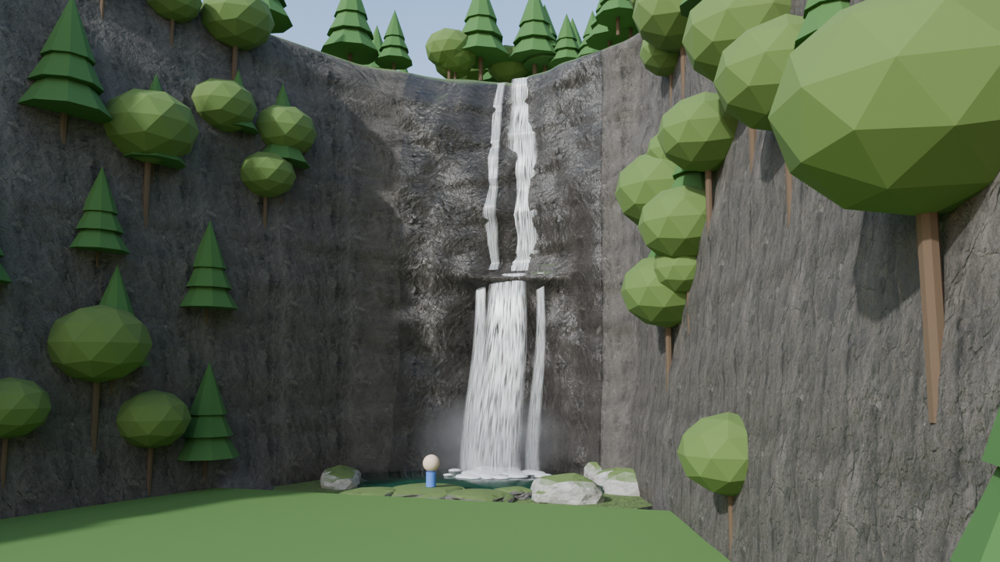
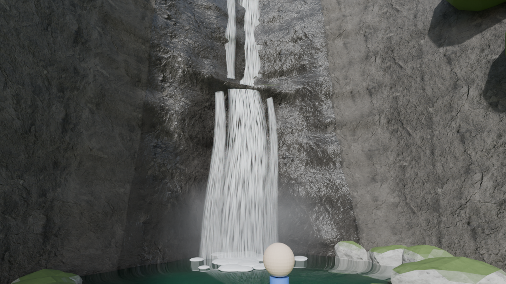
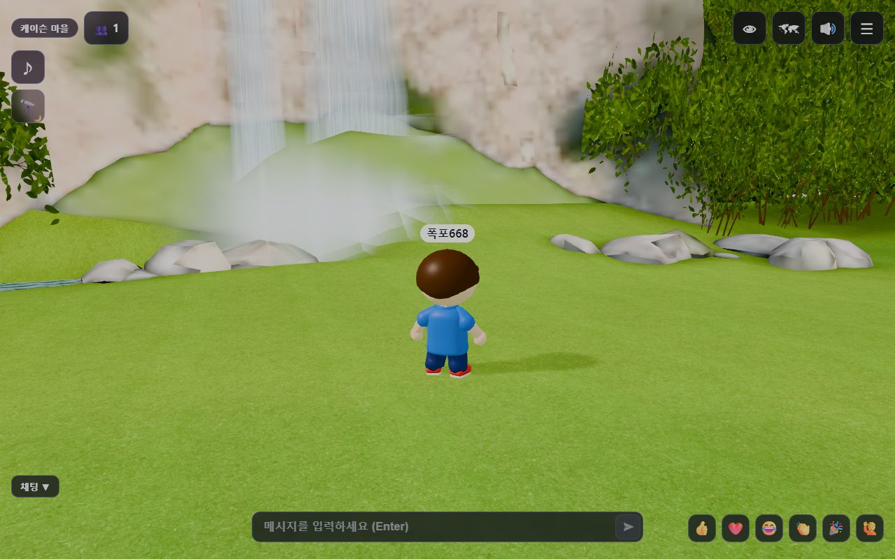
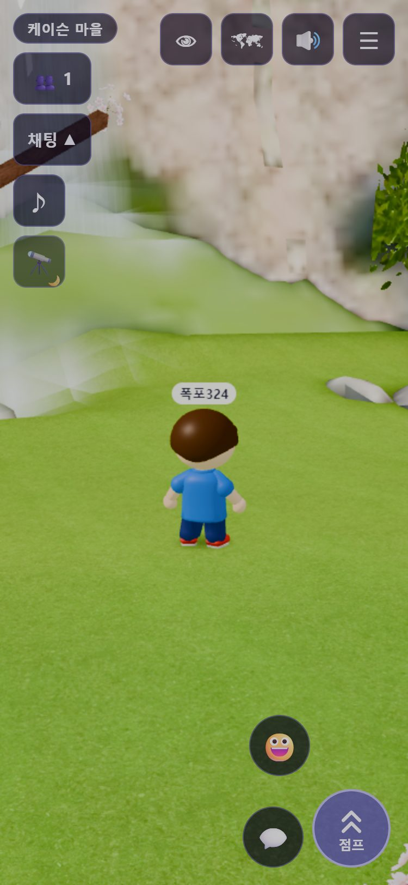
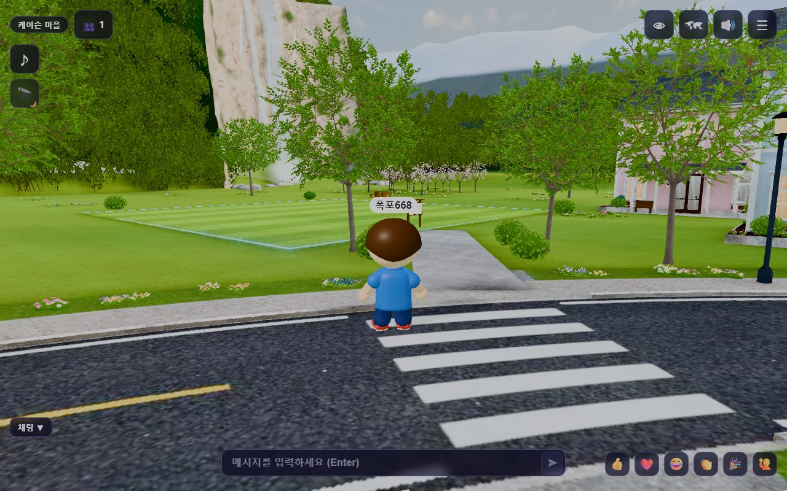
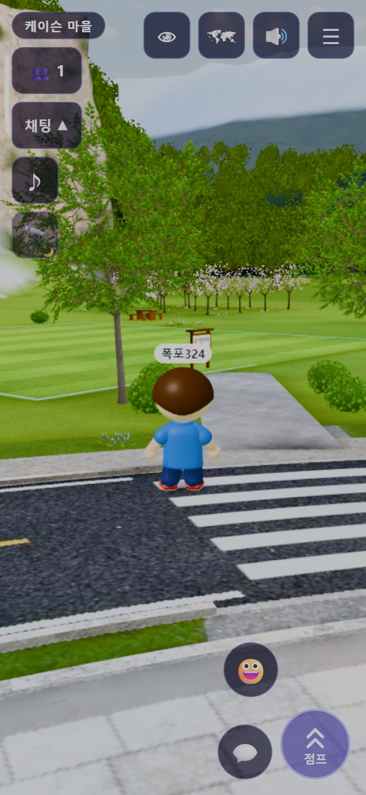
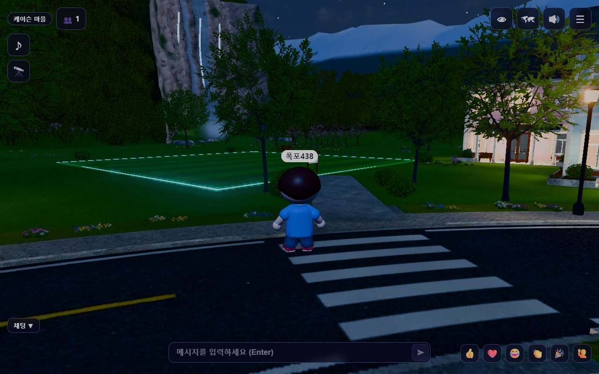
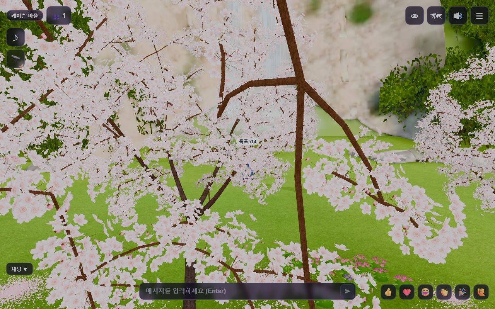

# B1 폭포 다시 만들기 — 설계안

작성 2026-11-16 · 브랜치 `feat/waterfall` · 상태: **설계안 (주인님 확인 대기)**

주인님 요청 (VILLAGE-TODO B1): "판때기 절벽을 입체 바위 절벽으로 바꾸고, 물이 실제로 흘러내려 물보라와 웅덩이가 생기게 해요."
관련 요청: B6 "걸어서 숲 가장자리까지 갈 수 있게 해요". 함께 지키는 규칙: [실제 사진 먼저], [평면 카드 금지, 버스 수준이 최소], [UX 쉬움 먼저], [전체 시험표를 먼저 준다].

---

## 0. 한눈에 보기

| 항목 | 지금 | 바꾼 뒤 |
|---|---|---|
| 절벽 | 분홍·베이지색 매끈한 판, 결이 없음, 바위 카드가 둥둥 떠 있음 | **회색 화강암 덩어리 절벽**: 세로 절리(갈라진 틈), 판상 박리 턱, 젖은 검은 줄, 틈의 이끼, 양옆은 숲 비탈 |
| 물줄기 | 파란 관(Tube) 3개 + 늘어난 카드. 밤에는 형광 줄 3개 | **위: 바위 홈을 타고 미끄러지는 계단 폭포 (36→17 m)**, **아래: 턱에서 떨어져 나와 포물선으로 떨어지는 17 m 주 폭포**, 흐름이 아래로 빨라지는 셰이더 |
| 웅덩이(소) | 풀밭 뒤에 숨어 거의 안 보임 | 에메랄드빛 **소**: 가장자리는 투명해서 자갈 바닥이 보이고, 떨어지는 자리에 거품·파문 |
| 물보라·안개 | 구 5개 + 점 28~96개 (CPU로 매 프레임 갱신) | GPU에서 움직이는 물방울 + 안개 덩어리, 가까이 가면 얼굴에 덮이지 않게 흐려짐 |
| 소리 | 없음 | 가까이 갈수록 커지는 폭포 소리 (Web Audio로 직접 만듦, 파일 0 바이트) |
| 걸어가기 | 걸음 경계(x = −95)에서 23 m 떨어진 배경 | **(제안) "폭포 쉼터"**: 소 앞 너럭바위까지 걸어가서 올려다보기 |
| 파일 | `village.glb` 안 (바꾸면 마을 전체 재빌드) | **따로 `waterfall.glb`** (+ 낮·밤 라이트맵). 마을은 옛 폭포를 빼는 **재빌드 1번**만 |


*블록아웃 1 — 마을 쪽에서 본 모습 (Blender Cycles, 회색 덩어리 나무는 자리 표시용). 파란 사람 = 아바타 키 2.16 m.*


*블록아웃 2 — 너럭바위 위 아바타 뒤 3인칭 시점. 주 폭포, 젖은 바위 띠, 안개, 소의 초록 물.*

블록아웃 스크립트: [`blockout_falls.py`](blockout_falls.py) (`blender -b --factory-startup -P blockout_falls.py`, 약 1분). 그 안의 `cliff_x(y, z)`가 절벽 모양 함수의 출발점이에요.

---

## 1. 실제 사진 조사 (Aside, 2026-11-16)

Google·Naver 이미지에서 한국의 작은 계곡 폭포 12장을 모았어요. 사진은 `art/village/refs/waterfall/`에 있고(git 제외, 공부용), 출처는 같은 폴더의 `SOURCES.md`에 있어요. 공개 저장소라서 사진 자체는 올리지 않고 주소만 적어요.

| # | 폭포 | 보이는 것 | 이미지 / 출처 |
|---|---|---|---|
| 01 | 비룡폭포 (설악산) | 10~20 m, 좁은 흰 물줄기, 어둡고 갈라진 화강암, 이끼, 빽빽한 숲 | [이미지](https://upload.wikimedia.org/wikipedia/commons/2/29/Biryong_Falls_2.jpg) · [Commons](https://commons.wikimedia.org/wiki/File:Biryong_Falls_2.jpg) |
| 02 | 비룡폭포 (설악산) | 옅은 회색 턱과 세로 균열, 어두운 바위 웅덩이 | [이미지](https://upload.wikimedia.org/wikipedia/commons/e/e0/%EB%B9%84%EB%A3%A1%ED%8F%AD%ED%8F%AC_%EC%84%A4%EC%95%85%EC%82%B0.jpg) · [Commons](https://commons.wikimedia.org/wiki/File:%EB%B9%84%EB%A3%A1%ED%8F%AD%ED%8F%AC_%EC%84%A4%EC%95%85%EC%82%B0.jpg) |
| 03 | 천당폭포 (설악산) | 넓은 화강암 판 위 계단 폭포, 여러 갈래 거품 물길, 작은 소들 | [이미지](https://upload.wikimedia.org/wikipedia/commons/3/3b/Cheondang_Waterfall_at_Seoraksan.jpg) · [Commons](https://commons.wikimedia.org/wiki/File:Cheondang_Waterfall_at_Seoraksan.jpg) |
| 04 | 구룡폭포 (지리산) | 바위 홈을 따라 미끄러지는 흰 계단 물, 둥근 화강암 판(너럭바위), 옆에 나무 데크 계단 | [이미지](https://img3.yna.co.kr/etc/inner/KR/2021/09/05/AKR20210905019100055_01_i_P2.jpg) · [연합뉴스](https://www.yna.co.kr/view/AKR20210905019100055) |
| 05 | 직소폭포 (변산) | 약 30 m 곧은 낙하, 어둡게 갈라진 바위벽, 물 뒤의 젖은 검은 면, 바닥 안개, 초록 소 | [이미지](https://www.buan.go.kr/upload_data/board_data/BBS_0000241/167525123650640.jpg) · [부안군](https://www.buan.go.kr/index.buan?menuCd=DOM_000000208001006000) |
| 06 | 직소폭포 (변산) | 넓게 본 협곡: 옅은 회색 벽, 둥근 바위가 둘러싼 소 | [이미지](https://www.buan.go.kr/upload_data/board_data/BBS_0000241/167525123650758.jpg) · [부안군](https://www.buan.go.kr/index.buan?menuCd=DOM_000000208001006000) |
| 07 | 용소폭포 (연하계곡) | 짧은 낙하 + 층진 바위 미끄럼, 올리브빛 소, 큰 바위 | [이미지](https://cdn.visitkorea.or.kr/img/call?cmd=VIEW&id=0629526a-8d45-4283-a17a-79ab688f2d79) · [대한민국 구석구석](https://korean.visitkorea.or.kr/detail/ms_detail.do?cotid=0257fb70-6a73-4f5d-9f2b-b34d9e33beb8) |
| 08 | 파래소폭포 (울산) | 매끈한 회색 화강암 홈통, 틈에 이끼, 깊은 초록 소 | [이미지](https://mblogthumb-phinf.pstatic.net/MjAyMDA1MjVfMjY1/MDAxNTkwMzg0MzM4OTY4.E4INCpFwtd2Ed-534C8YxKdhj_lEqjpBns0daMHqGDgg.BWJ8fcbvdWvd1r872dTVKDHtrZNB8UQ1M26SLFclJ2Ig.PNG.okyoky2000/1008.png?type=w800) · [블로그](https://m.blog.naver.com/okyoky2000/221978166746) |
| 09 | 삼부연폭포 (철원) | 3단 폭포, 각진 턱, 작은 소 | [이미지](https://www.hantangeopark.kr/img/sight_slide_05_01.jpg) · [한탄강 지질공원](https://www.hantangeopark.kr/bbs/content.php?co_id=sight_01_05) |
| 10 | 삼부연폭포 (철원) | 젖은 검은 바위, 이끼 선반, 갈라진 물줄기 | [이미지](https://www.hantangeopark.kr/img/sight_slide_05_02.jpg) · 같은 곳 |
| 11 | 용추폭포 (무릉계곡) | 촘촘히 갈라진 옅은 바위, 짙은 초록 소 | [이미지](https://cdn.visitkorea.or.kr/img/call?cmd=VIEW&id=29002939-d595-4659-97f5-dffd1858f9a3) · [대한민국 구석구석](https://korean.visitkorea.or.kr/detail/ms_detail.do?cotid=c675b4b8-dd5e-4b6b-ae93-bfce0565da0d) |
| 12 | 용추폭포 (함양) | **가장 좋은 전체 구도**: 바위 홈 속 흰 물줄기, 이끼 낀 회색 턱 절벽, 에메랄드 소, 앞쪽 둥근 자갈 기슭 | [이미지](https://mblogthumb-phinf.pstatic.net/MjAyMTA3MDNfMjMx/MDAxNjI1MjkxMzIyMTY2.w1LNsMFNQYCet1Io2qpKzw9d9wVAV--GNC1QFOR0z10g.m_4Rr0uhzaKBPp8lE_h9-bcCVH5LIv6uOAL_u06BTLAg.JPEG.travelgeo/20210515%EF%BC%BF124732.jpg?type=w800) · [블로그](https://m.blog.naver.com/travelgeo/222449724463) |

**사진에서 배운 것 (만들 때 그대로 지킬 것)**

1. **바위 색은 회색이에요.** 밝은 회색~쥐색 화강암에 노란 지의류 얼룩, 검은 물때 줄(물이 흐른 자리), 틈마다 초록 이끼예요. 지금의 분홍·베이지 절벽은 틀렸어요.
2. **바위 결:** 세로로 길게 갈라진 덩어리(절리)와 두께 0.5~1.5 m의 판상 턱이 함께 있어요. 케이크 같은 가로 줄무늬가 아니라 **각진 큰 덩어리**예요 (05, 11, 12).
3. **물은 바위가 파 놓은 홈(물길) 안을 흘러요** (04, 08, 12). 절벽 한가운데를 넓게 덮지 않아요. 주 물줄기 폭은 2~5 m이고 아래로 갈수록 조금 넓어지며 가장자리가 가는 가닥으로 갈라져요.
4. **두 가지 물 모양:** (a) 바위 면에 붙어 미끄러지는 계단 물(04, 03): 하얗게 부서지고 턱마다 튀어요. (b) 턱에서 떨어져 나와 공중으로 떨어지는 물줄기(05, 12): 위는 매끈하고 아래로 갈수록 부서져요. 우리 폭포는 **위 (a) + 아래 (b)** 2단이에요.
5. **물 뒤 바위는 젖어서 검고 번들거려요** (05). 떨어지는 자리 주변 바위도 젖은 띠가 있어요.
6. **소(웅덩이):** 에메랄드·올리브 초록. 가장자리는 투명해서 자갈 바닥이 보이고, 가운데는 짙어요. 떨어지는 자리에 흰 거품과 파문이 있고, 거품 줄이 흘러 나가는 쪽으로 끌려가요.
7. **기슭:** 둥근 자갈과 큰 바위, 그리고 사람들이 서는 **너럭바위**(넓고 평평한 화강암, 04). 소 앞에 서서 올려다보는 것이 한국 계곡의 전형적인 경험이에요.
8. **둘레는 숲:** 활엽수가 절벽 위와 양옆 비탈을 덮고 가지가 물 위로 늘어져요. 절벽은 숲 사이에 드러난 **30 m 남짓한 바위**예요.
9. **안개는 바닥에 낮게** 깔리고 바람 쪽으로 흘러요(05). 맑은 날 오전에는 무지개가 보이기도 해요.

---

## 2. 지금 상태 (게임 화면, main 7c81a1c 기준, 2026-11-16 찍음)

로컬 서버(2901)·클라이언트(5501), DEV `?time=` 고정. 걸음 경계 끝(x −93, z −76)이 지금 갈 수 있는 가장 가까운 곳이에요.

| 장면 | 화면 | 보이는 문제 |
|---|---|---|
| PC 낮, 경계 끝 |  | 분홍·베이지색 매끈한 절벽(흐린 저해상도), 늘어난 물 카드 2장, 바닥은 풀밭이라 소가 안 보임, 안개는 하얀 덩어리, 절벽 앞에 바위 카드가 떠 있음, 바위는 각진 로우폴리 |
| 휴대폰 낮, 경계 끝 |  | 같은 문제, 절벽 텍스처가 크게 뭉개짐 |
| PC 낮, 광장 서쪽 |  | 멀리서는 "판에 그린 폭포", 절벽이 숲과 붙지 않고 판처럼 서 있음 |
| 휴대폰 낮, 광장 서쪽 |  | 같음 |
| PC 밤, 광장 서쪽 |  | 물줄기가 **형광 줄 3개**로 보임 (가산 혼합 관이 밤에도 밝음) |
| PC 낮, 카메라 멀리 |  | 경계 끝에서 카메라를 빼면 벚나무가 폭포를 다 가림 → 폭포 쪽 시선 길에는 나무를 두지 않아야 함 |

**코드에서 본 것**
- `village.glb` 안: `parts_nature.py backdrop()`의 `waterfall_cliff`(40×30 격자 + 바위 26개, `BD_rock`), `M_waterfall` 리본 2줄 + 십자 안개 카드 15장, `A_foam` 고리, 소 원판(`backdrop_water`에 호수와 함께 합쳐짐), 소에서 개울로 가는 물길(`feeder_pts`).
- 런타임: `client/src/village/waterfall3d.ts`가 GLB의 `M_waterfall` 카드를 숨기고 관(TubeGeometry) 3개 + 토러스 거품 + 점 + 구 안개를 덧그림. 점 위치를 **매 프레임 CPU에서** 고쳐 올림.
- `villageModelPrep.ts`: `M_waterfall` 지도 굴리기(`FALLS_SPEED`, `fallsDown`). `bake_village.py`: `BD_WEIGHT["waterfall_cliff"] = 2.2`, `ALPHA`·`T_falls.png`.
- 배치 (`shared/src/village/villageLayout.ts`): `backdrop.waterfall = { centre (−118, −78), size 28×14, height 36, facing "e" }`, 걸음 경계 ±95. 절벽 면은 x ≈ −116, 소 중심 x ≈ −111.

---

## 3. 걸어서 갈 수 있게 할까? — 제안

**제안: B안 "폭포 쉼터"를 만들어요.** 소 앞 너럭바위까지 걸어가서 폭포를 올려다보는 것이 실제 계곡 폭포의 핵심 경험이고, B6("숲 가장자리까지 걷기")와 같은 방향이에요.

| | A안: 보기만 | **B안: 폭포 쉼터 (추천)** |
|---|---|---|
| 갈 수 있는 곳 | 지금처럼 x = −95까지 (소까지 12 m 이상) | 경계 밖으로 작은 주머니: **x −106 ~ −95, z −90 ~ −68** (11 × 22 m) |
| 경험 | 멀리서 보는 배경 | 너럭바위 위에서 물보라를 맞으며 올려다봄, 소리 커짐, 사진 찍기 좋은 자리 |
| 일 | 적음 | 걸음 영역·충돌·클릭 이동·카메라 막기 추가 (W5, §8) |
| 품질 부담 | 10 m 안에 들어오지 않음 | 10 m 안에서 봐야 하므로 바위·물 디테일이 버스 수준이어야 함 (예산 §6에 반영) |

**B안의 모양 (게임 좌표)**
- 들어가는 길: 지금 경계(x −95)의 z −86 ~ −70 구간이 열리고, 흙길 + 징검돌 몇 개로 너럭바위까지 이어져요 (구룡폭포 04의 나무 데크 대신 자연 바위 — 마을 규모에 맞게).
- 너럭바위 4장: 높이 0~0.4 m의 평평한 화강암, 걸을 수 있음(경사 < 8°). 가장 앞 바위 끝 x ≈ −104.5 = 소 물가.
- **소 안으로는 못 들어가요.** 물가에 충돌선. 클릭으로 소를 누르면 가장 가까운 물가 바위로 걸어가요 (B10의 "반응 없음"을 되풀이하지 않기).
- 주머니 서쪽·북쪽·남쪽은 바위와 덤불 충돌 상자로 막혀요. 남쪽 끝(z −68)에 소에서 나가는 물길이 있어서 물가 충돌이 있어요.
- 카메라: 절벽 안으로 들어가지 않게 x < −114.5에 카메라 금지 면, 위로 올려다보는 각도(1인칭 포함)가 폭포 끝(36 m)까지 닿게.
- 앉기(선택): 너럭바위 2곳에 "등받이 없는 자리"(양쪽 앉기 규칙). 주인님 확인 질문 Q3.

**B6과의 관계:** B6이 나중에 걸음 경계를 숲 쪽으로 넓히면 이 주머니는 그 안에 흡수되고, 소·바위 충돌만 남아요. 주머니는 `villageLayout.ts`에 `backdrop.waterfall.pocket`이라는 별도 사각형으로 두어(지금 추모관 홀처럼 `villageBounds`가 감싸고 막는 띠를 더하는 방식) B6과 따로 고칠 수 있게 해요.

---

## 4. 모양과 크기

게임 좌표 (x 동쪽, z 남쪽이 +, 단위 m). 블록아웃의 로컬 좌표 = (x + 118, −(z + 78)).

| 부분 | 값 | 근거 |
|---|---|---|
| 전체 높이 (절벽 꼭대기 물 시작) | **36 m** (layout `height` 그대로) | 뒤 능선(`terrain_h`의 `FALL.height + 5`)을 바꾸지 않으려고. 광장(120 m)에서 랜드마크로 보이는 크기 |
| 위 단: 계단 폭포 | 36 → 17 m, 바위 홈(폭 4~6 m, 깊이 2~2.5 m) 안을 미끄러짐, 턱 4~6개 | 구룡폭포(04), 천당폭포(03) |
| 아래 단: 주 폭포 | **17 m 자유 낙하**, 턱 끝(x ≈ −117)에서 초속 약 2 m로 나와 포물선 (턱보다 약 4 m 앞에 떨어짐), 폭 3.4 → 5.2 m + 옆 가닥 2줄 | 직소(05), 용추(12) |
| 물 뒤 굴 | 주 폭포 뒤 바위가 3 m 파여 들어감, 젖은 검은 면 | 직소(05) |
| 드러난 바위 폭 | 약 34 m. 그 밖은 50° 안팎의 숲 비탈로 앞(동쪽)으로 휘어 나와 **협곡**을 만듦 | 01, 06, 12 |
| 소 | 타원 반지름 동서 8.5 m, 남북 11 m, 중심 (−111.5, −78), 물면 y −0.25, 가운데 깊이 2.2 m, 가장자리 0.3 m | 지금 값과 같음 |
| 기슭 | 둥근 자갈 띠 1.5~3 m, 큰 바위 25~30개(0.7~2.2 m), 동쪽에 너럭바위 4장 | 12, 04 |
| 아바타 | 키 2.16 m: 너럭바위에서 주 폭포 턱까지 올려다보는 각 약 50°, 꼭대기까지 약 70° | |

---

## 5. 만드는 방법

### 5.1 절벽 (Blender, `build_waterfall.py`)

모두 스크립트로 만들어요 (AI 3D 생성 금지, 런타임 박스 쌓기 금지).

1. **큰 모양:** 블록아웃의 `cliff_x(y, z)`처럼 "협곡(앞으로 휘는 양옆) + 세로 절리(보로노이) + 판상 턱 + 위로 갈수록 뒤로 눕기 + 물 뒤 굴 + 위 단 물길 홈 + 주 폭포 턱"을 합친 높이장 함수로 0.25 m 격자(고해상도, 약 1.5 M 삼각형)를 만들어요.
2. **덩어리 느낌:** 높이장만으로는 "벽"으로 보여요(블록아웃의 약점). 그래서 **바위 키트**를 더해요: 각진 화강암 덩어리 메시 6종(Voronoi 파쇄 + 모서리 깎기, 각 600~1,200 삼각형)을 절벽 면에 반쯤 박아 30~40개 배치해 턱·튀어나온 덩어리·무너진 돌을 만들어요. 같은 메시 반복은 GLB에서 인스턴스로 내보내요.
3. **줄이기:** 고해상도 높이장 → 리메시/데시메이트로 **LOD0 18k 삼각형**(가까운 쪽 0.4 m, 꼭대기 1.2 m 밀도), **LOD1 6k**. 고해상도의 잔 굴곡은 노멀 맵이 아니라 **바위 텍스처 노멀 + 라이트맵 그림자**로 살려요(라이트맵을 고해상도에서 구워 저해상도에 넣음: `bake` 시 selected-to-active).
4. **재질 `M_falls_rock`:** CC0 `rock_face`(회색으로 채도 0.18까지 낮춤, 블록아웃과 같음) + `mossy_rock` 을 정점색으로 섞기.
   - 정점색 R = 이끼 (위를 보는 턱·틈 = 법선 z와 오목함으로 계산), G = 젖음 (물길·물 뒤·물보라 반경 8 m: 어둡게 ×0.45, 거칠기 0.35), B = 물때 검은 줄(물길 아래 세로 줄무늬).
   - 1024² 텍스처 2장(색 + 노멀), WebP. 월드 1 타일 = 4 m, 라이트맵 UV는 UV2.
5. **땅·기슭·소 바닥:** 사이트 상자(§7) 안의 땅을 이 GLB가 가져요. 경계 정점 높이는 마을 빌드가 내보낸 경계선 파일에서 읽어 이음매가 없게 해요. 소 바닥은 `river_small_rocks`, 기슭 자갈은 낮은 자갈 메시 인스턴스(30~60개), 너럭바위는 `dry_riverbed_rock`.
6. **초목 (GLB 안, 이 사이트만):** 바위 틈 이끼 덩어리, 고사리·덤불 다발 (마을의 잎 재질 `M_leaf_green` 규칙을 따른 입체 잎 다발, 카드 금지), 절벽 위 끝에서 물 위로 늘어지는 활엽수 가지 2~3개. 큰 숲은 마을의 기존 배경 숲(`village.glb`)이 사이트 둘레까지 오도록 재빌드 때 맞춰요.

**삼각형 예산 (GLB 전체)**

| 부분 | high | low (iPhone 13) |
|---|---|---|
| 절벽 LOD0 / LOD1 | 18k | 6k (LOD1) |
| 바위 키트 인스턴스 (6종 × 30~40) | 30k (인스턴스 전개 기준) | 12k (20개만) |
| 기슭 자갈·너럭바위·소 바닥·땅 | 8k | 5k |
| 물 메시 (리본·계단 막·소·거품) | 6k | 3k |
| 초목 다발 | 10k | 4k |
| **합계** | **≤ 72k** | **≤ 30k** |

마을 장면 합계 게이트(`village-perf.mjs` villageScene 300k)에 폭포를 더해 **high 372k / low 330k**로 새 게이트를 두고, 폭포 쪽은 위 표를 따로 검사해요.

### 5.2 물

물 메시는 모두 Blender에서 만들어 GLB에 넣고(모양은 아트, 움직임은 셰이더), 셰이더는 클라이언트에 있어요. 모든 물은 **가산 혼합을 쓰지 않아요**(밤 형광 줄의 원인). 일반 알파 혼합 + 낮·밤 밝기를 따라요.

1. **주 폭포 (`W_falls_plunge_*`)**: 포물선을 따라가는 굽은 리본 3~4겹(중심 두꺼운 흰 물, 양옆 가는 가닥, 뒤쪽 옅은 막). 리본마다 단면이 살짝 휜(앞으로 볼록) 6~8 정점 띠라서 옆에서 봐도 두께가 있어요.
   - UV: u = 가로 0..1, v = 흐른 거리(m)/4.
   - 정점색: R = 공기 섞임(아래로 갈수록 ↑), G = 속도(√낙하거리에 비례), B = 가장자리 부서짐.
   - 셰이더: `T_falls_flow`(512², R·G 줄무늬 노이즈 2장, B 거품 덩어리)를 v 방향으로 **속도 G에 맞춰** 두 속도(×1.0, ×1.7)로 굴려 겹침 → 아래로 빨라지는 물. 알파 = 노이즈 문턱 × 가장자리 감쇠 × R로 아래쪽이 부서져 가닥이 보이게. 색 = 물빛(빛 받는 쪽 밝음) ↔ 흰 거품. 프레넬로 가장자리가 하늘빛.
2. **위 단 계단 물 (`W_falls_cascade`)**: 물길 바위 면을 3 cm 띄워 감싼 막 메시. Blender에서 각 정점의 "흐름 방향 = 중력을 면에 투영한 방향"을 정점색 RG로 굽고, 셰이더는 **흐름 지도(flow map) 2위상 방식**으로 `T_falls_flow`를 그 방향으로 흘려요. 정점색 B = 턱 끝(경사 급변) → 흰 거품·튀김 세게.
3. **소 (`W_falls_pool`)**: 마을 물 셰이더(`villageWater.ts`의 `M_water`: 물결 노멀·하늘 반사·깊이 색)를 같이 쓰고, **파문 유니폼**을 더해요: 떨어지는 점 중심으로 바깥으로 퍼지는 고리 물결(sin(kr − ωt)·e^(−r/R)), 흰 거품 고리 텍스처를 바깥으로 흘림. 깊이 색은 정점색(가장자리 0.3 m는 투명·옅은 초록 → 가운데 짙은 에메랄드 #1E5A48 계열). 소에서 나가는 물길 쪽으로 거품 줄이 끌려가요.
4. **거품 (`W_falls_foam`)**: 떨어지는 자리의 낮은 볼록 거품 더미 메시(평면 고리 아님) + 정점 흔들림, 거품 텍스처 굴림.
5. **물보라·안개 (런타임, GPU)**: 인스턴스 사각형 하나(`InstancedBufferGeometry`)에 씨앗·위상 속성을 넣고 **정점 셰이더가 시간으로 위치를 계산** (CPU 갱신 0).
   - 물방울: 떨어지는 자리에서 튀어 오르는 포물선, 속도 방향으로 늘린 작은 물방울. high 160 / low 48.
   - 안개: 큰 부드러운 덩어리(256² 4×4 아틀라스 `T_mist_atlas`), 바닥에서 3~6 m 피어오르며 동쪽(마을 쪽)으로 흐름. high 28 / low 10.
   - 화면 덮임 방지: 카메라와 1.5 m 안에서는 0, 5 m에서 다 보임. 휴대폰에서 화면의 40% 넘게 안개가 겹치지 않게(시험 §9에서 잼).
   - (high만, 선택) 오전 해가 등 뒤일 때 안개에 옅은 무지개 띠.
6. **소리 (`fallsAudio.ts`)**: 파일 없이 Web Audio로 만들어요(버스 경적·별 차임처럼 마을의 공용 `villageAudioContext` 사용). 갈색 잡음 → 저역 통과(약 900 Hz) + 대역 통과 덩어리 2개 + 느린 흔들림 = "쏴아" 소리. 거리로 크기: 소 앞 1.0, 30 m 0.35, 80 m 0.08, 광장(120 m) 0. 메뉴의 "소리" 끄기·효과음 크기를 따르고, 숨은 탭에서 멈춰요. 쉼터 안에서는 배경음악을 0.6배로 줄여요.

### 5.3 낮과 밤

- 절벽은 동쪽을 봐요. 마을 굽기의 해(`LOOK.sun_azimuth_deg`, 동북동 노을)가 절벽 면을 비춰서 낮에는 밝게 보여요.
- `waterfall.glb`는 **마을과 똑같은 방식으로 낮·밤 라이트맵 2장**(각 1024², WebP 낮 82 / 밤 76)을 가져요. 굽기는 마을 굽기 장면(`village_lmprep.blend`)의 해·하늘·달 설정을 그대로 불러와서 하고, 마을 배경 지형을 그림자용으로만 넣어요 → 이음매에서 밝기가 같아요.
- 런타임은 마을의 `dayNight.applied` 섞기 값(낮↔밤 라이트맵 섞기, `domeTint`)을 그대로 써요. 물 셰이더도 같은 값으로 어두워져요(밤에 빛나지 않게).
- 밤 조명 (주인님 질문 Q2): 기본안은 **쉼터 바닥의 낮은 따뜻한 등 2개**가 폭포 아래쪽 10 m만 은은하게 비추는 것 (밤 라이트맵에 구워 넣음, 런타임 조명 추가 0). 원하지 않으시면 달빛만.

---

## 6. 성능 예산 (iPhone 13, low 등급)

| 항목 | high | low | 재는 법 |
|---|---|---|---|
| `waterfall.glb` 크기 (Draco) | ≤ 1.6 MB | 같은 파일 | `village-perf.mjs --mode assets`에 폭포 게이트 추가 |
| 라이트맵 | 1024² 낮 + 밤 WebP (합 ≤ 400 KB) | 같음 (밤 것은 밤 가까울 때만 받음, 마을과 같은 규칙) | |
| 텍스처 | 바위 2장 1024², 흐름 512², 안개 256² | low는 1024 → 512로 줄여 올림(`LIGHT_TIER_MAX_TEXTURE` 규칙) | |
| 드로콜 (폭포가 화면에 있을 때 더해지는 것) | ≤ 12 | ≤ 7 | `__cvRenderInfo` |
| 삼각형 | ≤ 72k | ≤ 30k | `__cvRenderInfo` |
| 투명 겹침 | 물 리본 ≤ 3겹 | ≤ 2겹, 안개 10개 | |
| CPU | 매 프레임 할 일 = 유니폼 몇 개 갱신뿐 (배열 갱신 0) | | |
| 프레임 시간 | 쉼터에서 폭포를 꽉 채워 볼 때, 같은 자리 `?falls=off` 대비 **+2 ms 이하** (휴대폰 375×812, CPU 4배 느리게, 30명) / 절대 게이트 33 ms 그대로 | | `village-perf.mjs` 방식 |
| 실기 | 주인님 iPhone 13: 쉼터에서 끊김 없이 (눈으로 확인) | | |
| 첫 접속 | 폭포 GLB는 **마을이 뜬 뒤 늦게 받음** (첫 화면 15 MB 게이트에 안 들어감). 받기 전에는 아무것도 안 그림(옛 카드 없음) | | |
| 멀리서 | 120 m 넘으면 물보라·소리 멈춤, 절벽 LOD1 | | |

---

## 7. 파일 나누기: 따로 GLB + 마을 재빌드 1번

**결정: `client/public/models/village/waterfall.glb`로 따로 만들어요.** 폭포를 고칠 때마다 마을 전체(굽기 384 샘플 낮·밤, 몇 시간)를 다시 하지 않아도 되고, A10 낚시 호수 작업과도 파일이 겹치지 않아요.

### 7.1 "사이트 상자" 약속

- `layout.backdrop.waterfall.site = { minX: −140, maxX: −100, minZ: −104, maxZ: −58 }` (게임 좌표).
- 이 상자 안의 땅·절벽·소·기슭은 **전부 `waterfall.glb`** 몫이에요. 마을은 이 상자 안에 아무것도 그리지 않아요(구멍).
- 마을 빌드는 구멍 테두리 정점(위치·높이)을 `art/village/work/waterfall_site_edge.json`으로 내보내고, 폭포 빌드는 이것을 읽어 자기 땅 테두리를 똑같이 맞춰요.

### 7.2 `village.glb`에서 바꿀 것 (재빌드 1번에 모두)

| # | 파일 | 바꿀 것 |
|---|---|---|
| V1 | `art/village/tools/parts_nature.py` `backdrop()` | `waterfall_cliff`(격자 + 바위 26개) 삭제 |
| V2 | 같은 곳 | `M_waterfall` 리본 2줄, 십자 안개 카드 15장, `A_foam` 고리 삭제 |
| V3 | 같은 곳 | `disc(fx + 7, fz, 8, 11, …)` 소 원판 삭제 (호수 원판은 그대로) |
| V4 | 같은 곳, `axis()` 격자 루프 | 사이트 상자 안 면은 건너뛰기(구멍) + 테두리 정점 JSON 쓰기 |
| V5 | `parts_nature.py` `terrain_h` | 절벽 뒤 능선은 그대로 두되, 사이트 상자 테두리에서 폭포 GLB 땅과 높이가 같도록 (테두리 높이 = JSON 값) |
| V6 | `build_village.py` 땅 격자 (`GROUND_HALF` 112 안, x < −100 부분) | 사이트 상자와 겹치는 면 건너뛰기 |
| V7 | `build_village.py` `feeder_pts()` | 첫 점을 새 소의 나가는 곳 (−106, −67)으로. 사이트 안 물길은 폭포 GLB가 그림 |
| V8 | `bake_village.py` | `BD_WEIGHT`의 `waterfall_cliff` 삭제. `M_waterfall`은 쓰는 메시가 없어지므로 표에서 빼도 되고 그냥 둬도 됨 (빼는 것 추천) |
| V9 | 마을 배경 숲 (`parts_trees.py`/`parts_fill.py`) | 사이트 상자 둘레까지 숲이 오게, 상자 안에는 나무 없음. 걸음 경계~폭포 시선 길(x −95 ~ −100, z −86 ~ −70)에는 큰 나무 금지 |
| V10 | `make_textures.py` | `falls()`(T_falls)는 더 안 씀 — 남겨도 무해, 삭제는 주인님 OK 뒤 |

V1~V10과 함께 **노란 중앙선 공백(`bay_zone`)·B6 먼 산·A10 호수**처럼 다른 작업도 `village.glb` 재빌드를 기다리고 있어요. 재빌드는 그것들과 **한 번에 묶어서** 하는 것을 추천해요(§8 W6).

### 7.3 클라이언트에서 바꿀 것

- 새 폴더 `client/src/village/falls/`: `FallsModel.tsx`(늦은 로드, 등급별 LOD), `fallsMaterials.ts`(주 폭포·계단 막·소 셰이더), `fallsSpray.ts`(GPU 물보라·안개), `fallsAudio.ts`.
- `VillageModel.tsx`: `waterfall3d.ts` 대신 `FallsModel`. DEV `?falls=off|old` 스위치(비교·성능 측정용).
- **마을 재빌드 전**에도 개발할 수 있게: `FallsModel`은 옛 GLB의 `waterfall_cliff`, `M_waterfall` 메시를 숨기고(지금 `hideWaterfallCards`와 같은 방식), 새 소 물면을 옛 원판보다 3 cm 위에 둬요. 재빌드가 끝나면 이 숨기기 코드와 `waterfall3d.ts`, `villageModelPrep.ts`의 `M_waterfall`/`FALLS_SPEED`/`fallsDown` 부분, 관련 시험을 지워요.

### 7.4 GLB 이름 약속 (아트 ↔ 클라이언트)

| 노드/재질 | 뜻 |
|---|---|
| `falls_rock_lod0`, `falls_rock_lod1` / `M_falls_rock` | 절벽 (UV2 라이트맵, 정점색 이끼·젖음·물때) |
| `inst__falls_rock_k` | 바위 키트 인스턴스 (k = 0..5) |
| `falls_ground` / `M_falls_ground` | 사이트 땅·기슭·자갈 |
| `falls_slab_n` / `M_falls_slab` | 너럭바위 (걸을 수 있는 면, 충돌은 shared에서) |
| `W_falls_plunge_n` / `M_falls_water` | 주 폭포 리본 (정점색 R 공기, G 속도, B 가장자리) |
| `W_falls_cascade` / `M_falls_cascade` | 위 단 막 (정점색 RG 흐름 방향, B 턱) |
| `W_falls_pool` / `M_water` | 소 물면 (정점색 = 깊이) |
| `W_falls_foam` / `M_falls_foam` | 거품 더미 |
| `W_falls_outlet` / `M_water` | 사이트 안 물길 |
| `veg__falls_*` / `M_leaf_green` | 초목 다발 |
| `marker__falls_impact` | 떨어지는 점 (물보라·파문·소리의 중심) |
| `marker__falls_lip` | 주 폭포 턱 (물보라 위쪽 시작) |

---

## 8. 만드는 순서와 나누기 (병렬)

```
W0 모양 고정(설계자, 0.5일) ──┬── W1 바위·땅 아트 ──┬── W3 굽기 ──┐
                              ├── W2 물 메시·텍스처 ─┘            ├── W7 전체 시험·검토 ── 배포
                              ├── W4 클라이언트 런타임 (블록아웃 GLB로 시작) ┤
                              ├── W5 걷기·충돌·카메라 (shared) ───────────────┤
                              └── W6 마을 재빌드 (A10·B6·bay_zone과 묶음) ──┘
```

| 묶음 | 하는 일 | 가진 파일 (이 사람만 고침) | 모델 |
|---|---|---|---|
| **W0** 모양 고정 | `cliff_x`·턱 높이·소 타원·사이트 상자·쉼터 사각형·이름 약속을 코드로 고정 | `art/village/tools/falls_shape.py`, `shared/src/village/villageLayout.ts`의 `backdrop.waterfall` 필드 추가만 | 강한 모델 |
| **W1** 바위·땅 | 절벽 높이장·바위 키트·LOD·기슭·너럭바위·초목·재질, 참고 사진과 나란히 렌더 | `art/village/tools/build_waterfall.py`, `parts_falls_rock.py`, `make_falls_textures.py`(바위 쪽) | sonnet |
| **W2** 물 메시·텍스처 | 리본·계단 막(흐름 방향 굽기)·소·거품·물길 메시, `T_falls_flow`, `T_mist_atlas` | `art/village/tools/parts_falls_water.py`, `make_falls_textures.py`(물 쪽 함수) | sonnet |
| **W3** 굽기 | 낮·밤 라이트맵, 후처리, `waterfall.glb` 내보내기 | `art/village/tools/bake_waterfall.py`, `post_waterfall.py`, `client/public/models/village/waterfall*.{glb,webp}` | sonnet |
| **W4** 런타임 | 늦은 로드·셰이더·GPU 물보라·소리·낮밤·등급·DEV 스위치, 단위 시험 | `client/src/village/falls/*`, `VillageModel.tsx`의 폭포 줄 | sonnet (셰이더 검토는 강한 모델) |
| **W5** 걷기 | 쉼터 주머니·막는 띠·소/바위 충돌·카메라 금지 면·클릭 이동(소 클릭 → 물가)·지도 표시·서버 시험 | `shared/src/village/villageLayout.ts`(waterfall 부분), `villageLayout.test.ts`, 클릭 이동 격자, 카메라 막기 | sonnet |
| **W6** 마을 재빌드 | §7.2 V1~V10 + 묶인 다른 작업, 빌드 순서 전체(`docs/houses-m1.md`), 옛 런타임 코드 지우기 | `parts_nature.py`, `build_village.py`, `bake_village.py`, `parts_trees.py`/`parts_fill.py`, `village.glb`·라이트맵, `waterfall3d.ts`, `villageModelPrep.ts` | 강한 모델이 지휘 |
| **W7** 시험·검토 | §9 전체 시험표, 사진 나란히, 성능 | 증거 폴더만 | 시각 검토 + 기술 검토 따로 |

- W1·W2·W4·W5는 W0 다음에 **동시에** 시작해요. W4는 블록아웃을 같은 이름 약속으로 내보낸 임시 GLB로 시작해요.
- W1과 W2는 `build_waterfall.py`(W1 소유)가 `parts_falls_water.py`(W2 소유)를 불러 쓰는 구조라서 서로 파일이 안 겹쳐요. 계단 막은 절벽 면을 감싸야 하므로 W2는 W1의 `falls_shape.py` 함수(W0 고정)만 읽어요.
- **A10 낚시 호수**도 `parts_nature.py backdrop()`(호수 원판·정자)을 고칠 가능성이 커요. W6은 A10 쪽과 같은 재빌드로 묶고, 그 전까지 두 작업 모두 `parts_nature.py`를 직접 고치지 않고 각자 새 파일에서 작업해요.
- 각 묶음은 넘기기 전에 §9 중 자기 몫을 **스스로 다 통과**해야 해요.

---

## 9. 전체 시험표 (만드는 사람이 넘기기 전에 다 통과)

### 9.1 카메라 자리 × 방향 × 기울기

| 자리 | 좌표 (x, z) | 무엇을 봄 |
|---|---|---|
| S1 처음 들어온 곳 | (0, 14) | 멀리서 폭포 실루엣·흰 물줄기 |
| S2 광장 서쪽 끝 | (−30, −5) | 절벽이 숲에 박혀 보이는지 |
| S3 절 부지 표지판 | (−40, −33) | 중간 거리, 물 흐름 보이는지 |
| S4 추모관 문 앞 | (0, −49.4) | 다른 방향에서 본 폭포 |
| S5 다리 위 | (−24, 75) | 남동쪽에서 비스듬히, 나가는 물길 |
| S6 쉼터 입구 | (−95, −78) | 이음매(마을 땅 ↔ 폭포 땅) |
| S7 쉼터 가운데 | (−100, −79) | 전체 폭포 |
| S8 앞 너럭바위 끝 | (−104, −79) | 가장 가까운 곳: 바위·물·거품·안개 디테일 |
| S9 쉼터 북쪽 끝 | (−100, −88) | 옆에서 본 주 폭포 두께, 물 뒤 굴 |
| S10 쉼터 남쪽 끝 | (−100, −69) | 나가는 물길, 물가 충돌 |

- 방향: 8개 (0°, 45° … 315°). 기울기: 0.05, 0.2, 0.35, 0.6, 1.0 + 거리 기본(6)과 최대.
- 1인칭: S7·S8에서 위로 끝까지 올려다보기, 아래 물 보기, 360° 돌기.
- 판정: 10 m 안에 평면 카드·판때기 0, 이음매·틈·떠 있는 바위 0, 물이 아래로 흐름(두 프레임 비교), 카메라가 바위 속에 들어감 0, 옛 소 원판과 새 소가 깜빡임 0, 안개가 화면 40% 넘게 덮음 0, 나무가 폭포를 다 가림 0(S2~S8 기본 거리).

### 9.2 기기·시간·등급

- PC 1280×800 그리고 1920×1080 (마우스) / 휴대폰 375×812 터치 (iPhone 13 세로).
- 시간 (DEV `?time=`, 2026-11-03 KST): 06:49 새벽, 12:30 낮, 17:06 노을, 21:00 밤.
- 등급 high / low.
- 위 9.1을 PC·휴대폰 × 낮·밤 전부, 새벽·노을은 S1·S7·S8만.

### 9.3 걷기·클릭 (B안일 때)

- 마을 → 쉼터를 걸어서·클릭으로·스틱으로 들어가고 나오기 (PC, 휴대폰).
- 소 물면 클릭 → 가장 가까운 물가 바위로 걸어감, 표시 동그라미가 바로 보임. 소 안으로 들어가지 못함.
- 쉼터 서·북·남 끝을 따라 걸어 보기: 바위 사이로 빠져나감 0, 걸림 0.
- 쉼터 안에서 다른 플레이어 보기(두 탭), 점프·이모지.
- (Q3 OK이면) 너럭바위 앉기 양쪽.
- 서버 시험: 주머니 밖으로 위치 강제 → 서버가 되돌림.

### 9.4 소리

- S8 = 가장 큼, S6 줄어듦, S2 거의 없음, S1 0. 메뉴 "소리" 끄기 → 0. 숨은 탭 → 멈춤. iPhone 첫 터치 뒤 소리 남(공용 AudioContext 규칙).

### 9.5 성능

- `__cvRenderInfo`: S8에서 드로콜·삼각형이 §6 표 안.
- 휴대폰 375×812, CPU 4배, low, 30명(봇 29): S1과 S8에서 프레임당 바쁜 시간 ≤ 33 ms, S8에서 `?falls=off`보다 +2 ms 이하.
- `village-perf.mjs --mode assets`: `waterfall.glb` ≤ 1.6 MB, 텍스처 ≤ 1024, 삼각형 ≤ 72k. `--mode load`: 첫 접속 ≤ 15 MB 그대로(폭포는 늦게 받음).
- 콘솔 에러 0.

### 9.6 사진 나란히

- 참고 사진 12(용추), 05(직소), 04(구룡)와 같은 구도의 게임 화면을 나란히 놓은 비교 시트 (낮). 밤 시트 1장.
- 버스와 같은 화면에 들어오는 것은 없지만, "버스 수준 디테일"을 S8 1인칭 화면으로 판정.

---

## 10. 주인님께 여쭤볼 것

- **Q1. 걸어서 소 앞까지 (B안) 갈 수 있게 할까요?** 추천은 B안(너럭바위 쉼터)이에요. A안이면 W5가 빠지고 바위 디테일 예산을 낮춰요.
- **Q2. 밤에 폭포에 은은한 조명을 둘까요?** 추천: 쉼터 바닥의 따뜻한 등 2개 (실제 공원 경관조명처럼, 화려한 색 조명은 아님). 아니면 달빛만.
- **Q3. 너럭바위에 앉을 수 있게 할까요?** (등받이 없는 자리 = 양쪽에서 앉기)
- **Q4. 높이 36 m를 유지할까요?** 실제 한국 계곡 폭포는 10~30 m가 많아요. 36 m를 유지하면(추천) 뒤 능선을 그대로 두고 광장에서 잘 보여요. 더 작고 아담하게(예: 22 m) 하면 뒷산 모양도 같이 바뀌어요.
- **Q5. 무지개(맑은 오전, 안개 속)를 넣을까요?** high 등급만, 작은 일이에요.

---

## 11. 하지 않는 것

- 물속 수영·물에 들어가기, 물고기 (A10 낚시 호수 몫).
- 물리 기반 유체 시뮬레이션 (휴대폰에서 불가능, 셰이더 + 메시로 충분).
- B6의 다른 숲 가장자리 넓히기 (쉼터만 B6과 같은 방식으로 준비해 둠).

---

## 12. W0 모양 고정 결과 (2026-11-16, 주인님 "추천대로")

결정: 높이 36 m 유지, B안 너럭바위 쉼터(걸을 수 있음), 소에는 못 들어감(소 클릭 → 가장 가까운 물가), 너럭바위 옆 등받이 없는 돌 의자 2개(양쪽 앉기), 밤에 따뜻한 바닥 등 2개, 오전 안개 무지개는 high 등급만. 모두 `layout.backdrop.waterfall.options`의 스위치로 남겨 둠.

**고정된 것 (하나의 출처)**
- 숫자(위치·크기): `shared/src/village/villageLayout.ts` `backdrop.waterfall` (시험: `villageWaterfall.test.ts`). Blender 쪽은 `layout.json`으로 읽어요.
- 바위 모양 함수: `art/village/tools/falls_shape.py` (git 제외 폴더라서 사본: [`tools/falls_shape.py`](tools/falls_shape.py)). `face_x(z, y)` 절벽 면, `terrain_y(x, z)` 사이트 땅(소 바닥·기슭·쉼터 0·나가는 물길·고원·물길 골짜기·이음매), `plunge_path()`, `cascade_path()`, `pool_*()`, `outlet_*()`, `walk_surface_ok()`. 순수 Python(직접 만든 노이즈)이라 Blender 버전과 상관없이 똑같아요. `python falls_shape.py --check`로 약속을 스스로 검사.
- 모든 숫자·표본 표: [`falls-contract.json`](falls-contract.json) (`--export-contract`로 다시 씀; 시험이 layout과 같은지 확인).
- 이음매: 사이트 상자 둘레 1 m마다 172점 (`site_edge_points()`), 파일 `art/village/work/waterfall_site_edge.json` (지금은 현재 마을 지형으로 만든 임시본 `--edge-provisional`; 사본 [`waterfall_site_edge.provisional.json`](waterfall_site_edge.provisional.json)). `terrain_y`는 상자 5 m 안에서 이 높이에 정확히 맞춰져요.
- 렌더: [`w0-wide.png`](w0-wide.png), [`w0-pool-view.png`](w0-pool-view.png), [`w0-plan.png`](w0-plan.png) (`render_falls_shape.py`, 사본 `tools/`). 물·재질은 자리 표시용, 모양만 판정.

**설계안에서 바뀐 것**
- 카메라 금지 면: `x < −114.5` 한 줄이 아니라 **선(`cameraWall`, z −98..−58, 2 m마다)**. 협곡 양옆 바위가 x −110 근처까지 나와서 한 줄로는 카메라가 바위에 들어가요.
- 나가는 물길: 소 남쪽 끝 (−110.4, −68.6) → (−107, −58). 사이트 안은 폭포 GLB가 그림. **V7 변경**: 마을 `feeder_pts()`는 첫 점 (−109, −76)을 지우고 (−107, −58)에서 시작, 그 점의 물 높이는 −0.30 이하.
- 걷기 높이: 이 게임은 바닥 높이가 없어서(y = 0) 너럭바위 윗면은 0.02~0.04, 주변 자갈이 낮아서 바위처럼 보이게. 돌 의자는 0.42 m 높이의 따로 된 돌(충돌 상자 + 앉기 자리).
- **V5b (W6)**: 마을 땅은 쉼터 상자(x −106..−95, z −90..−68) 안에서 0, 밖 2 m에 걸쳐 원래 높이로 (`pocket_flatten`). 이음매 파일도 이 규칙으로 만들어요.

---

## 13. W5 걷기·충돌·카메라·클릭 이동 결과 (2026-11-16, `feat/falls-w5`)

코드: `shared/src/village/fallsWalk.ts` (순수 함수, 서버·클라이언트가 `villageGeometry`로 같이 씀), 시험 `fallsWalk.test.ts`(shared) · `fallsMovement.test.ts`(server) · `fallsClick.test.ts`(client), 실제 게임 점검 `e2e/falls-walk.mjs`.

- **걷는 영역**: 마을 걸음 영역(`areas.village`)은 그대로 두고, `villageWalkArea()` = 영역 + 쉼터 주머니(x −106..−95). 서버 경계(`villageBounds`)와 클라이언트 `VILLAGE_ACTIVE_MAP.bounds`가 이것을 써요. 주머니의 북쪽(z −95..−90)·남쪽(z −68..95) 띠(x −106..−95)는 단단한 상자라 한 걸음(4.8 m)이 건너가도 막혀요.
- **소**: 물가 타원 + 0.6 m 에서 몸 반지름(0.4)을 뺀 만큼(+0.1 여유)을 0.125 m 칸 계단 상자 약 100개로 막아요(몸 중심은 물가에서 0.6 m 이상 떨어짐 = `walk_surface_ok`). 너럭바위 4장 위(칸이 통째로 바위 안)는 열려 있어요: 앞 바위는 물 위로 x −104.5까지 나가고, 몸은 −104.1쯤까지 가요.
- **돌 의자 2개**: 충돌 상자 + 앉는 자리 **8개**(돌마다 서·동쪽 × 두 자리). 좌석 번호는 맨 뒤에 붙여서(카페 의자·현관 벤치 다음) 앞의 번호는 그대로예요. 각 자리는 앞 모서리가 있어서 자기 쪽에서만 권해지고, 두 쪽 사람은 돌의 자기 반쪽에 등을 맞대고 앉아요. 탭: `seatTap.ts`가 돌 위를 탭하면 탭한 쪽·자리의 의자를 골라요.
- **카메라**: `cameraWall` 선을 구간마다 상자(서쪽 사이트 끝 ~ 구간의 가장 동쪽 점, 높이 45 m)로 만들어 스프링 암이 막아요(북·남 끝도 사이트 끝까지). 어떤 상자도 주머니 서쪽 끝 3 m 안으로 오지 않아요.
- **클릭 이동**: 소(물가 타원 + 0.6 m, 바위 제외)를 누르면 `PlanOptions.shore`가 클릭을 **가장 가까운, 입구에서 이어지는 서 있을 자리**로 바꿔요(링도 거기). 소 전체를 집을 수 있게 `ActiveMap.pickBounds`가 집기 범위를 소의 서쪽 끝까지 넓혀요.
- **지도 이름**: 주머니 안(x < −95)은 HUD에 "폭포 쉼터".
- **W0 숫자에서 알게 된 것**: 남쪽 돌 의자 끝(z −68.65)과 주머니 남쪽 끝(z −68) 사이는 0.65 m라 몸(0.8 m)이 못 돌아가요. 의자 양옆에서 앉고 서는 데는 문제 없어요(시험은 이 틈을 "몸이 못 서는 틈"으로 둠).
